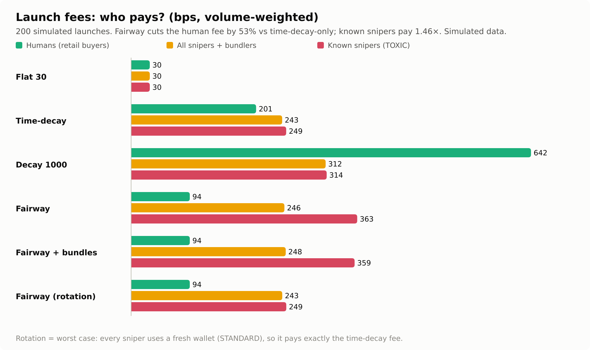
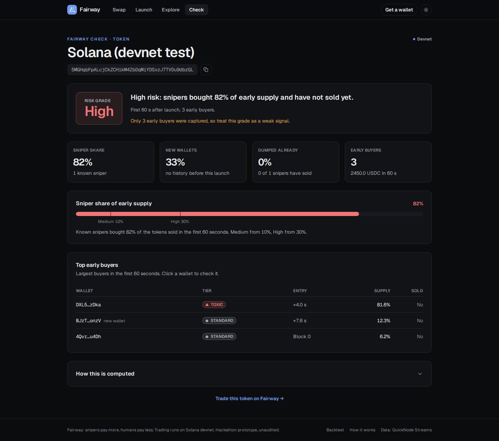
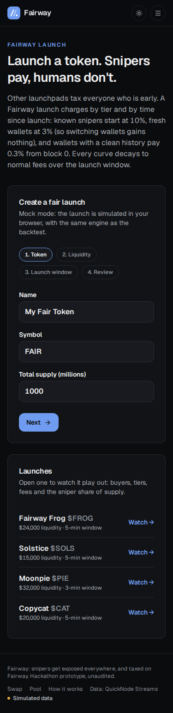
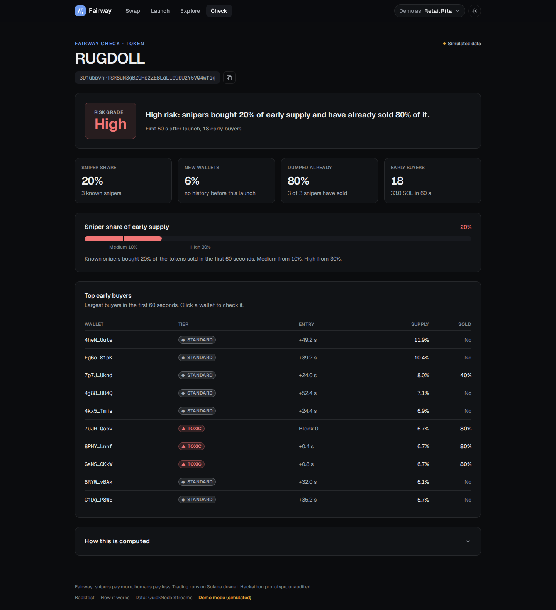
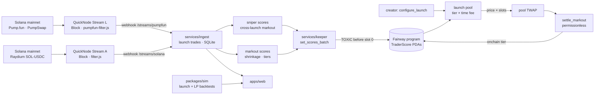

# Fairway Launch

**Fair token launches on Solana. Known snipers pay more, humans pay less.**

*Other launchpads tax everyone who's early. Fairway taxes snipers.*

**Fairway Check: know who you're buying from.** Snipers get exposed everywhere, and taxed on Fairway. [See the report](#fairway-check-know-who-youre-buying-from).

> **Headline (synthetic launch simulation, 200 launches), compared with a time-decay-only launch fee (everyone pays 300 → 30 bps over 5 minutes):**
> - **Humans pay 53% less** in the launch window (201 → 94 bps), in every one of the 200 launches.
> - **The sniper share of early supply falls from 49% to 27%.**
>
> Snipers pay about the same in total (1.01×). That is **deterrence**: a known sniper faces a 10% fee at block 0, so most known snipers skip the launch, and the supply they would have taken goes to humans. The known snipers who still buy pay 1.5× per dollar (245 → 371 bps). Honest limits: snipers on **fresh wallets** pay exactly the time-decay fee (Fairway can't tell them apart from new humans), and **creator fee income is lower** than under time-decay ($591 vs $1,399 per launch) because humans pay less. Details: [Launch economics](#launch-economics), [`docs/ECONOMICS.md`](docs/ECONOMICS.md#8-launch-economics-m16).

A launch on Fairway is a normal Fairway pool with a **launch fee curve**. During the launch window (default 750 slots ≈ 5 minutes) each tier's fee decays linearly from a start fee to its normal fee: **TOXIC 1000 → 80 bps, STANDARD 300 → 30, RETAIL 30 → 5**. The tier comes from the signer's onchain `TraderScore` PDA. Wallets that have sniped **Pump.fun** launches before are found through a **QuickNode Stream** and scored TOXIC **before the token exists**. A fresh wallet always pays the STANDARD curve. After the window, the pool keeps scoring trades **onchain against its own TWAP**, because a new token has no oracle.

The same engine also runs a liquid SOL/USDC pool (markouts against Pyth, a bot-tax rebate, a protocol share). Those results are now the **secondary evidence**: [Liquid-pair results](#liquid-pair-results-solusdc-secondary-evidence-synthetic).

> **Hackathon status, read this first.** The Anchor program is **deployed on devnet** (`8jo3xry2rp9rQHwPCyh8c9Qwnw2HHa5JvAUiXHo2XPXk`), unaudited. The web app's default experience reads **real devnet data only**: every Fairway pool via `getProgramAccounts`, real swaps through Phantom, real `SwapExecuted` events. Simulated data appears only behind the hidden `?demo=1` flag and on the research pages (`/backtest`), which say so. No live Stream has run yet, so the "Live on Pump.fun" tab is empty until one does. The Pump.fun and PumpSwap program IDs in the launch filter and the devnet Pyth SOL/USD account were verified onchain on 2026-11-19 ([details](streams/STREAM_CONFIG.md#program-ids-verified-2026-11-19)). The Raydium SOL-USDC vault addresses were checked against mainnet. See [What is simulated vs. live](#what-is-simulated-vs-live).

**Fairway is bot-friendly: good bots pay less, extractive flow pays its fair share.** The fee follows measured behaviour (markout), not whether the signer is a human or a program.



## Fairway Check: know who you're buying from

**Snipers get exposed everywhere, and taxed on Fairway.** Paste any Solana token mint at `/check` and get a public fairness report in a second: who bought in the first 60 seconds, how much of the early supply went to known snipers, how many wallets are brand new, and how much the snipers have already dumped. It needs no wallet, no signup and no fee. It is built from the same QuickNode Stream data and the same cross-launch sniper scores that set the launch fee tiers, so a wallet that is exposed on Check is the wallet that pays the sniper fee on a Fairway launch.

| | |
|---|---|
|  |  |
|  |  |
|  |  |

*All screenshots except the last show real devnet data (badge: "Devnet"). The last one is the hidden `?demo=1` mode on synthetic fixtures (badge: "Simulated data"). Pump.fun data, once a Stream runs, is badged "Real mainnet data via QuickNode Streams · updated <time>".*

- **Token report** (`/check/<mint>`): one risk grade (Low / Medium / High) with a plain-English verdict, then **sniper share** of early supply, **new-wallet share**, **dumped already**, early buyers, a sniper-share meter, the **top early buyers** (tier badge, entry time, share, sold) and a collapsible "How this is computed".
- **Wallet report** (paste a wallet instead): tier, launches participated in, first-block buys, average markout, recent trades.
- **Grade thresholds** (documented in [`docs/ECONOMICS.md` §9](docs/ECONOMICS.md#9-fairway-check-the-token-report)): **High** if snipers hold ≥ 30% of the early supply (or ≥ 15% with at least half already dumped), **Medium** from 10%, **Low** below. **"Fair launch verified"** (also shown on `/launch/[id]`) needs under 10% and at least 10 early buyers.
- **API:** `GET /api/check/token/:mint`, `GET /api/check/wallet/:address`, `GET /api/check/tokens` (web), and the same routes at `/check/...` on the ingest service. **SDK:** `checkToken(mint)`, `checkWallet(address)`, `listChecks()` in `@fairway/sdk`, with typed responses.
- **Data:** the Pump.fun / PumpSwap Stream (Stream L) fills the ingest DB; every buy in the first 60 seconds and the later sells by those buyers are in the stored launch trades. In fixture mode it runs on synthetic launches (ten tokens with a designed Low / Medium / High spread, `packages/fixtures/data/checks.json`, plus the existing Pump.fun fixtures). **No live Stream has run yet:** [`docs/SETUP_REMAINING.md` §5b](docs/SETUP_REMAINING.md) has the steps to run one for 1–2 hours.
- **Honest limits:** a "known sniper" is a wallet that bought early in at least 3 launches and was ahead afterwards (or is funded by a known bundler). A sniper on a fresh wallet looks like any new wallet, so Check understates their share; the grade is evidence, not a verdict ([`docs/RISKS.md` §10f](docs/RISKS.md)).

## For judges

**In three lines.** (1) A Solana launch pool whose fee depends on **who** is buying and **when**: the per-tier fee decays over a 5-minute window, so a known sniper pays 10% at slot 0, a fresh wallet 3% and a proven human 0.3%. (2) "Known sniper" comes from a QuickNode Stream over Pump.fun / PumpSwap history (wallets that buy in the first seconds of launch after launch and profit right after), written onchain by a keeper. After launch, the program scores every trade **itself** against the pool's own TWAP, with no oracle operator. (3) A 200-launch simulation shows who pays and who gains, including where it does not work: fresh-wallet snipers, and lower creator income than time-decay (see [Launch economics](#launch-economics)).

| Criterion | What to look at | Proof |
|---|---|---|
| Technical execution | Anchor program: a per-tier launch fee curve on slots (`configure_launch`), an onchain price-time TWAP accumulator in the pool account, permissionless TWAP markout settlement, signer-derived score PDAs, plus the liquid-pair machinery (Pyth settlement, bot-tax rebate, treasury, rent sponsorship). **49 LiteSVM tests**, including the wrong-signer attack during a launch, swaps before the launch slot, fee decay and TWAP scoring | [`instructions/launch.rs`](programs/fairway/src/instructions/launch.rs), [`swap.rs`](programs/fairway/src/instructions/swap.rs), [`settle.rs`](programs/fairway/src/instructions/settle.rs), [`fairway-math/launch.rs`](crates/fairway-math/src/launch.rs), [`twap.rs`](crates/fairway-math/src/twap.rs), [`tests/fairway.rs`](programs/fairway/tests/fairway.rs) |
| Product & UX | `/launch` create wizard (mock, and live against a local validator), `/launch/[id]` launch replay with a buyers list (tier, fee paid, onchain-verified vs bootstrap score; the score source is illustrative in mock mode), a sniper-share meter and a **"Same buy, two wallets"** panel; launch backtest as the default `/backtest` view; dark mode; mock mode needs no wallet | [`launch-wizard.tsx`](apps/web/components/launch-wizard.tsx), [`launch-view.tsx`](apps/web/components/launch-view.tsx), [`launch-explorer.tsx`](apps/web/components/launch-explorer.tsx) |
| Innovation | The launch tax keys on the **wallet's history across past launches**, not only on time. A fresh wallet can never pay less than STANDARD, so rotation removes the surcharge but never earns a discount. Oracle-less tokens are scored onchain against the pool's own TWAP | [How a Fairway launch works](#how-a-fairway-launch-works), [`packages/scoring/src/sniper.ts`](packages/scoring/src/sniper.ts), [`docs/ECONOMICS.md`](docs/ECONOMICS.md#8-launch-economics-m16) |
| Impact & potential | Humans pay 53% less in the launch window than under time-decay-only, and the sniper share of early supply falls from 49% to 27% (deterrence: known snipers skip the launch), and the revenue model is a launch fee plus a share of the toxic premium. Honest limits are stated: fresh-wallet snipers, lower creator fees | [Launch economics](#launch-economics), [`docs/RISKS.md`](docs/RISKS.md) |
| Demo | `pnpm demo` runs everything offline in one command; a shot-by-shot 2–3 minute script built around a launch | [Quick start](#quick-start), [`docs/DEMO_SCRIPT.md`](docs/DEMO_SCRIPT.md), [`docs/PITCH.md`](docs/PITCH.md) (5-minute script + Q&A) |

**Per-prize requirements**

- **DeFi track**
  - [x] A new fee primitive: launch fee = f(trader tier, slots since launch), [`configure_launch`](programs/fairway/src/instructions/launch.rs), [`swap.rs`](programs/fairway/src/instructions/swap.rs), [`fairway-math/launch.rs`](crates/fairway-math/src/launch.rs)
  - [x] Price discovery without arbitrage: an onchain pool TWAP as the markout reference, [`twap.rs`](crates/fairway-math/src/twap.rs), [`settle.rs`](programs/fairway/src/instructions/settle.rs)
  - [x] Economic design: [Launch economics](#launch-economics), [Economic design](#economic-design), [`docs/ECONOMICS.md`](docs/ECONOMICS.md)
  - [x] Risk assumptions: [Risk assumptions](#risk-assumptions), [`docs/RISKS.md`](docs/RISKS.md) (TWAP manipulation, launch Sybils, bundlers)
  - [x] Program addresses: [Program IDs](#program-ids) (localnet and devnet)
  - [x] Simulation evidence, with limits stated: [`packages/sim/src/launch.ts`](packages/sim/src/launch.ts), [`packages/sim/out/launch.json`](packages/sim/out/launch.json)
- **Best use of Solana**
  - [x] Anchor program, PDAs (`config`, `pool`, `vault`, `lp_mint`, `score`, `treasury`), SPL Token vaults and LP mint: [`state.rs`](programs/fairway/src/state.rs), [`pool.rs`](programs/fairway/src/instructions/pool.rs)
  - [x] Slot-native design: the launch curve and the TWAP run on slots (400 ms), the TWAP lives in the pool account (64 observations, updated in place under the 4 KB SBF stack)
  - [x] Program IDs and a Solana-usage explanation: [Program IDs](#program-ids), [How we use Solana](#how-we-use-solana)
  - [x] Solana-native data: v0 transactions with lookup tables, token-balance and lamport deltas, Anchor events: [`packages/parser/`](packages/parser/src)
  - [ ] Devnet deployment: not done (needs the human steps in [`docs/SETUP_REMAINING.md`](docs/SETUP_REMAINING.md))
- **QuickNode Streams bounty**
  - [x] **Stream L, launches:** Solana mainnet, Block dataset, filter [`streams/pumpfun-filter.js`](streams/pumpfun-filter.js) (Pump.fun + PumpSwap create/buy/sell), webhook `POST /streams/pumpfun` → cross-launch sniper scores. Config, filter logic and why: [`STREAM_CONFIG.md` §Stream L](streams/STREAM_CONFIG.md#stream-l-pumpfun--pumpswap-launches--known-sniper-scores-m16)
  - [x] **Stream A, liquid pairs:** [`streams/filter.js`](streams/filter.js) (vault-delta swap extraction) → `POST /streams/solana`
  - [x] Both filters are standalone, generated from the parser code the ingest service runs, and tested against `getBlock`-shaped fixtures: [`streams/pumpfun-filter.test.ts`](streams/pumpfun-filter.test.ts), [`streams/filter.test.ts`](streams/filter.test.ts)
  - [x] Webhook receiver with signature check, idempotent storage and scoring: [`services/ingest/`](services/ingest/src/app.ts), [`launches.ts`](services/ingest/src/launches.ts)
  - [ ] A live Stream running: not yet created (needs a QuickNode account). The Pump.fun program IDs are verified ([details](streams/STREAM_CONFIG.md#program-ids-verified-2026-11-19))

## The problem

- **Launches are won by snipers.** On a new token, bots buy in the first seconds, before any human can react, and sell into the crowd that follows. In our flat-fee simulation they take **54% of the supply** sold in the first 5 minutes.
- **Today's fix taxes everyone.** Launchpads and pools use a time-decaying "anti-sniper" fee: high at the start, falling to normal. It hits the sniper and the human who bought one second later in the same way, so humans pay ~200 bps in the window to stop bots that just pay it too.
- **The information exists.** Snipers are repeat players. The same wallets snipe launch after launch on Pump.fun, and that history is public onchain.
- (Liquid pairs have the same shape: arbitrage bots trade against stale AMM prices and LPs lose it (LVR), while every trader pays the same fee. That is the [secondary evidence](#liquid-pair-results-solusdc-secondary-evidence-synthetic).)

## How a Fairway launch works

1. **Create.** The creator mints the token, creates a Fairway pool and adds liquidity (the first deposit locks 1,000 LP units). Then they call **`configure_launch(launch_slot, window_slots, curve, creator_share_bps)`**: launch slot (0 = now), window (default 750 slots ≈ 5 min, max 216,000), an optional custom curve and the creator's share of the sniper premium (default 50%). It only works **before the first swap**. A non-admin creator pays a **0.05 SOL launch fee** to the protocol treasury. `/launch` does all of this in three transactions.
2. **Before the launch slot,** swaps are refused (`LaunchNotStarted`), so a creator can schedule the opening and nobody trades before it. From the launch slot on, the first buyers face the highest fees.
3. **During the window,** each tier's fee decays linearly: `fee = end + ⌈(start − end) × (window − elapsed) / window⌉`.

   | Tier | Who | Slot 0 | Halfway | Last window slot | After the window (`Config` fee) |
   |---|---|---:|---:|---:|---:|
   | TOXIC | **known snipers** (keeper, from Pump.fun history) or proven-toxic flow | 1000 bps | 540 | 82 | 80 |
   | STANDARD | every wallet without a score, **including every fresh wallet** | 300 bps | 165 | 31 | 30 |
   | RETAIL | wallets with proven uninformed history | 30 bps | 18 | 6 | 30 minus the bot-tax rebate |

   The tier is read from the `TraderScore` PDA derived from the **signer**, so nobody can borrow someone else's RETAIL score (tested during a launch: `wrong_signer_attack_is_still_blocked_during_a_launch`). There is no bot-tax rebate inside the window.
4. **Known snipers come from QuickNode Streams.** Stream L runs [`pumpfun-filter.js`](streams/pumpfun-filter.js) over Solana mainnet blocks and extracts every Pump.fun / PumpSwap create, buy and sell. [`scoreSnipers`](packages/scoring/src/sniper.ts) marks each **early buy** (within 25 slots of the create) against the token's price 75 slots later. A wallet that sniped **≥ 3 different launches** with a shrunk score **≥ 500 bps** is TOXIC. One lucky early buy never qualifies. The keeper writes these tiers onchain with `set_scores_batch` (dry-run by default).
5. **After launch, the program scores trades itself.** A new token has no Pyth feed, so `configure_launch` turns on **TWAP scoring**: every swap and liquidity change records a price × slots observation in the pool account (64 observations, ≥ 8 slots apart). `settle_markout` marks each queued trade against the **25-slot TWAP ending 75 slots after the trade**. The reference price is the pool's post-trade spot, so a trader's own price impact never counts as "information". Wallets build onchain-verified scores on the token they launched into, with no oracle operator.



## Launch economics

200 simulated launches (seeded, `packages/sim/src/launch.ts`): 15 minutes each, $10k–40k of initial liquidity, 2–8 snipers per launch (75% of them **known** from past launches, so TOXIC from slot 0; the rest on fresh wallets, so STANDARD), in half the launches a **bundler** splitting ~$6k across 3–8 fresh wallets (STANDARD), about 160 human buys of ~$80 (60% of humans have RETAIL history, the rest are new wallets), and a few uninformed bots. Snipers buy when their expected profit beats the fee, and the hype-driven human crowd arrives over the first minutes. Means per launch:

| Regime (5-minute window) | Human fee | Known-sniper fee | Sniper share of window supply | Human entry vs listing price | Sniper profit | Creator (LP) fees | Protocol |
|---|---:|---:|---:|---:|---:|---:|---:|
| Flat 30 bps (no protection) | 30 bps | 30 bps | 54% | +163% | $6,918 | $220 | $7.50 |
| Time-decay 300 → 30, everyone | 200 bps | 245 bps | 49% | +160% | $5,325 | $1,399 | $7.50 |
| Aggressive time-decay 1000 → 30, everyone | **641 bps** | 314 bps | 1% | +117% | $71 | $1,458 | $7.50 |
| **Fairway, tier × time** | **94 bps** | **371 bps** | **27%** | **+129%** | **$2,432** | $591 | $8.59 |
| Fairway + bundle detection (60% of bundles from a known bundler, an assumption) | 94 bps | 366 bps | **21%** | +123% | $1,734 | $494 | $8.59 |
| Fairway worst case: every sniper on a fresh wallet | 94 bps | 246 bps | 49% | +158% | $5,346 | $1,156 | $7.50 |

What it shows, honestly:

- **Humans pay 53% less than under time-decay** (paired across the same 200 launches), in every launch.
- **The sniper share of early supply falls from 49% to 27%.**
- **Snipers paying about the same is deterrence. Known snipers mostly stay out.** At 1000 bps they rarely buy at all: their notional falls from $25k to under $300 per launch, so the 371 bps is paid on a small volume. Total sniper profit falls 54% vs time-decay.
- **Pooled over all snipers, the fee per trade is about the same as time-decay (1.01× paired).** The snipers that still trade are the fresh-wallet ones, and they pay the STANDARD curve, which *is* the time-decay curve. Fairway removes known snipers. It cannot price snipers it has never seen.
- **Wallet rotation is the floor, not a failure.** If every sniper uses a fresh wallet, they pay exactly the time-decay fee and take the same share as under time-decay, and humans with history still pay 94 bps.
- **Creators earn less fee income than under time-decay** ($591 vs $1,399), because the time-decay income is mostly paid by humans. Creators get a fairer distribution and a lower human entry price instead. They also get **50% of the sniper premium paid to them directly** (configurable, claimable even if their liquidity is locked), but that is only ~$3.63 per launch on average: when deterrence works, there is little premium to share. See [`ECONOMICS.md` §8.4b](docs/ECONOMICS.md#84b-creator-share-of-the-sniper-premium-default-50). An aggressive time-decay curve also stops snipers, but it charges humans 641 bps.
- **Bundle detection.** A QuickNode Streams funding check (the same Stream L) links fresh wallets funded by one source within ~10 minutes before a launch. Flagged wallets pay at least STANDARD, and TOXIC when the funder is a known bundler. In the 100 simulated launches with a bundle, the bundle's share of early supply falls from **20% to 7.5%**, and snipers + bundles together from 39% to 27%. Honest notes: without detection, Fairway gives bundles *more* early supply than time-decay (20% vs 10.5%), because the known snipers it keeps out leave room. The 60% detection rate is an assumption. Funding through an exchange or a fresh hop each time is not linked. Creator fees fall further ($494), because the deterred bundlers paid fees too. Details: [`streams/STREAM_CONFIG.md`](streams/STREAM_CONFIG.md#bundle-detection-wallet-fundings-in-the-same-stream-m16-step-11).
- **Protocol:** the 0.05 SOL launch fee (~$7.50) plus 15% of the toxic premium (~$1 per launch here).

Chart of the curves: [`docs/charts/launch-schedule.png`](docs/charts/launch-schedule.png). Regenerate: `pnpm --filter @fairway/sim launch` then `pnpm charts`. More detail, including who benefits: [`docs/ECONOMICS.md` §8](docs/ECONOMICS.md#8-launch-economics-m16).

## The engine: markout scores

Launch pools and liquid pairs share one scoring engine. A launch uses it in two places: the known-sniper bootstrap (step 6) and onchain TWAP scoring after the launch (step 5).

1. **Markout.** For each past trade we ask: did the price move in the trader's favor shortly after? `markout_bps = side × (mid(t+h) − execPrice) / execPrice × 10,000`, with `side = +1` for a buy and `−1` for a sell. We use the pre-fee price, because we measure information, not cost. The primary horizon is 30 s (5 s and 60 s are also stored).
2. **Score.** `score = Σ(notional × markout) / (Σ notional + K)`, with `K = 2,000` quote units. The shrinkage toward 0 means one lucky trade cannot move a wallet far.
3. **Tier.**

   | Tier | Rule (defaults, one config object) | Fee |
   |---|---|---|
   | `TOXIC` | score ≥ 10 bps and ≥ 5 trades | 80 bps |
   | `RETAIL` | score ≤ 3 bps, ≥ 5 trades and ≥ 3 days of history | 30 bps minus the bot-tax rebate (floor 5 bps) |
   | `STANDARD` | everyone else, **including every new wallet** | 30 bps |

4. **Onchain lookup.** The `swap` instruction derives the `TraderScore` PDA from the **signer** (`["score", trader]`). If it is missing, stale (older than `score_ttl_slots`) or malformed, the swap pays STANDARD. A bot cannot pass someone else's RETAIL account, because the seeds check fails.
5. **Onchain verified scoring.** Every Fairway swap is queued in the signer's `TraderScore` (a 4-entry buffer of `{pool, exec_price, slot, side, notional}`; the PDA is created on the first swap, with the rent sponsored by the protocol treasury when it can, else paid by the trader). After `markout_slots` (default 75 slots, about 30 s) **anyone** can call `settle_markout(trader)` for a pool. It reads that pool's Pyth price account (or, on a launch pool without an oracle, the pool's own TWAP), applies the same markout formula, shrinkage `K` and tier thresholds as `packages/scoring`, and updates the wallet's onchain tier. See [Scoring and trust model](#scoring-and-trust-model).
6. **Data layer.** QuickNode Streams filter Solana blocks server-side. Stream L extracts Pump.fun / PumpSwap launch trades for the sniper scores. Stream A extracts swaps on chosen liquid pools, so backfill scores wallets from day one using their activity on other DEXs (Raydium SOL-USDC is configured; Orca and Meteora only need their vault addresses added). The live streams keep scores fresh.

## Scoring and trust model

Each `TraderScore` PDA holds two independent scores:

| | Bootstrap score | Onchain verified score |
|---|---|---|
| Written by | the keeper (`score_authority`) with `set_score` / `set_scores_batch` | the program only: `swap` queues trades, `settle_markout` scores them |
| Inputs | history on every venue, from QuickNode Streams (Raydium today) | the wallet's own swaps on pools that have a Pyth oracle (set per pool with `set_pool_oracle`; feed id, staleness ≤ 60 s and confidence ≤ 0.5% checked) |
| Horizons | 5 s / 30 s / 60 s, float, "all horizons" rule | one horizon (`markout_slots` = 75 ≈ 30 s), integer bps, primary-horizon rule |
| Expiry | TTL (`score_ttl_slots`), then STANDARD | does not expire |
| Trust | trust the keeper (it can mislabel, but cannot set fees or touch funds) | trust Pyth and the program; no operator |

**Blend rule** (`fairway_math::resolve_blended`, mirrored in the SDK as `resolveBlendedTier`): while a wallet has less than `Config.markout.onchain_min_notional` (default **1,000 USDC**) of settled onchain notional, or fewer than 5 settled trades (the tier rules' minimum), the keeper's bootstrap tier applies, exactly as before. Once it has both, **the onchain tier wins** and keeper writes no longer change that wallet's fee. `set_score` still updates the bootstrap fields, but it never touches the onchain fields. The keeper skips such wallets to save fees.

**Trust model, before and after.** Before M13, every tier came from one trusted signer. Now the keeper only seeds new wallets (and covers history Fairway cannot see onchain). Any wallet that trades meaningfully on Fairway graduates to a score that anyone can recompute from the chain, and the keeper cannot override it. A compromised keeper can no longer give an active bot RETAIL pricing.

Details that keep it hard to game:

- The trade minimum matters: without it, a bot the keeper knows is TOXIC could do 3 large flat trades, pass the notional threshold and drop to STANDARD (tested: `few_large_trades_do_not_override_a_toxic_keeper_score`).
- `settle_markout` only accepts the PDA seeded by the `trader` argument (a wrong-trader account fails `ConstraintSeeds`), and it only uses a Pyth price **posted after** each trade's horizon.
- If the 4-entry buffer is full, the new trade is not queued (`dropped_trades += 1`) and **gets no RETAIL discount**. A wallet cannot hide trades and still pay 5 bps.
- Trades not settled within `max_settle_slots` (450) expire unscored. The wallet keeps its current tier, so the worst case is STANDARD pricing for unscored flow. There is no crank reward in the MVP: LPs, the keeper and retail wallets (who want RETAIL) have the incentive to crank.
- **Same math in TypeScript and Rust:** `crates/fairway-math/src/markout.rs` and `packages/scoring/src/onchain.ts` both run on `crates/fairway-math/vectors/onchain.json` (markout signs, price conversion, shrinkage, tier boundaries). The TS suite also checks that the integer path gives the same tier as the float scorer, and a score within 1 bps.
- Prices are 1e12 fixed point (quote per base), so a $0.00002 memecoin keeps 7 significant digits. The program assumes the quote token is USD-pegged (USDC), so a base/USD Pyth feed is the mid.
- **The oracle is per pool.** A pending trade is tagged with its pool and settled only against that pool's feed (`Pool.oracle_price_account` / `oracle_feed_id`). A pool with no oracle (for example a test memecoin that has no Pyth feed) still trades and charges tiers from keeper scores, but builds no onchain evidence, creates no score account and cannot trigger the full-buffer cap. Tested: `each_pool_settles_only_against_its_own_oracle`, `pool_without_oracle_is_not_scored_onchain`.

## Business model

Snipers and bots pay a premium; part of it goes back to retail, a small part to the protocol, the rest stays with LPs (on a launch pool, usually the creator), and the scores themselves can be licensed.

| Who | What they get | Where it shows |
|---|---|---|
| **Creators** | A launch where humans pay ~94 bps instead of ~200 in the window and known snipers take half the early supply they otherwise would. All swap fees as the pool's LP, plus 50% of the sniper premium paid directly (`claim_creator_fees`). Less fee income than a time-decay launch ($591 vs $1,399 per simulated launch): that is the cost of not taxing their own buyers | `/launch`, `/launch/[id]` |
| **Retail** | Never more than a normal 30 bps pool, and a **bot-tax rebate** (RETAIL tier pays 30 bps minus a rebate funded by 10% of the previous epoch's toxic premium, floor 5 bps) once their own trades show no informed edge | `/swap`, "Same trade, two wallets" |
| **Good bots** | The same fee as retail if their flow is uninformed (market makers, hedgers, rebalancers). "Verified fair flow" is earned from measured behaviour, not from being human | `/wallet/[address]` badge |
| **Extractive flow** | Pays its fair share: TOXIC tier (80 bps) for arbitrage and sniping. Wallet rotation gets STANDARD (30), never the rebate | `/pool` headline "Extra fees earned from bots" |
| **LPs** | Every fee except the protocol's premium share, plus 73% less LVR in the sim (LP-neutral within noise). **Not** proven better than a flat 30 bps pool: +$15 ± 33/day before the protocol share, −$56 ± 31/day after it. See the [verdict](#liquid-pair-results-solusdc-secondary-evidence-synthetic) | `/pool`, `/backtest` |
| **Protocol** | A **0.05 SOL launch fee** per launch (`Config.launch.launch_fee_lamports`, paid to the treasury PDA by non-admin creators in `configure_launch`), plus `Config.protocol_fee_bps` = **15% of the toxic premium only** (the toxic fee above the STANDARD fee; max 50%), about $72/day on the simulated $3M pool. Accrued per pool and claimed into the treasury PDA by anyone. It takes nothing from retail or standard fees | `/pool` "Protocol revenue" |
| **Other DEXes** | Read a wallet's score with one call and price flow with it. Licensing the scores (an access API and SLA, or a revenue share when another DEX routes by Fairway tiers) is the next revenue line, not built yet | [Any Solana DEX can read Fairway scores](#any-solana-dex-can-read-fairway-scores) |

**Rebate mechanics.** `update_retail_fee` (permissionless, once per `rebate.epoch_slots`, default 9,000 slots ≈ 1 h) reads the pool's epoch counters (toxic premium, RETAIL-tier volume) and sets `rebate = min(share × premium ÷ retail_volume, retail_fee − floor)` and a budget of `share × premium` for the next epoch. `swap` never gives a RETAIL wallet more than the epoch rate, more than the budget left, or a fee below the floor, so the rebate can never exceed the premium collected. Zero toxic flow in an epoch means zero rebate.

**Protocol fee mechanics.** The protocol's share of each toxic premium stays in the vault but is booked in `Pool.protocol_owed_*` and excluded from the reserves that price the curve and the LP shares. `claim_protocol_fees` (permissionless) moves it into token accounts owned by the treasury PDA `["treasury"]`. Only the admin can move treasury funds out (`treasury_transfer_tokens`, `treasury_withdraw_sol`). On launch pools the creator's share of the same premium (`Pool.creator_share_bps`, default 50%) is booked the same way in `Pool.creator_owed_*`, and the permissionless `claim_creator_fees` pays it only into token accounts owned by `Pool.creator`.

**Sponsored score accounts.** A trader's first swap on a scored pool creates their `TraderScore` PDA (about 0.0023 SOL of rent). The treasury pays that rent when it holds more SOL than its own rent-exempt minimum plus the rent; otherwise the trader pays (fallback). The account is flagged `sponsored`, and `close_score` refunds the treasury, not the trader. The treasury is funded by anyone sending SOL to its address (the seed script sends 0.05 SOL). Treasury SOL is a cost of onboarding, so a deployment should fund it from the protocol's fee revenue.

**The cost side is real.** The protocol's 15% of the premium and the 10% rebate both come out of the bot premium that would otherwise go to LPs, so LPs net less than the pre-protocol figures; the backtest tables show both. The default leaves LPs $56 ± 31/day below a flat 30 bps pool after the protocol share. Charging the protocol 15% of *all* fees instead would cost LPs about $215/day, which is why the share is premium-only. See [`docs/ECONOMICS.md`](docs/ECONOMICS.md).

## Any Solana DEX can read Fairway scores

`TraderScore` accounts are public PDAs (`["score", wallet]`). Another AMM, an aggregator or a wallet can price flow by tier without trusting our API:

```ts
import { Connection, PublicKey } from '@solana/web3.js';
import { getFeeTier } from '@fairway/sdk';

const t = await getFeeTier(new Connection(rpcUrl), new PublicKey(wallet));
// { tier: 0|1|2, tierName: 'RETAIL'|'STANDARD'|'TOXIC', feeBps, source: 'onchain'|'score'|…,
//   verified: boolean,            // true = computed by the Fairway program from the wallet's own trades vs Pyth
//   onchain: { scoreBps, settledTrades, settledNotional } | null, isNew: boolean }
```

- **One read, no signer.** `getFeeTier` fetches `Config` and the wallet's score PDA and resolves the tier exactly as the program does (keeper bootstrap until the onchain evidence threshold, then the onchain tier; stale or missing → STANDARD; a full pending buffer removes the RETAIL discount). If you already hold the two accounts, call the pure `feeTierFromAccounts(wallet, config, score, slot)`.
- **From onchain code (CPI-free).** Derive the PDA `["score", wallet]` under the Fairway program id, check its owner, and read the `tier` / `onchain_tier` / `sum_notional` fields (layout in [`state.rs`](programs/fairway/src/state.rs) and the IDL `packages/sdk/idl/fairway.json`). The blend rule is in [`resolve_blended`](crates/fairway-math/src/tier.rs).
- **Trust.** `verified: true` means the tier comes from the program's own markout computation. Otherwise it is the keeper's bootstrap score (trusted, expires after `score_ttl_slots`).
- **Not built yet:** a hosted API, rate limits, SLAs or a revenue share. Those are the licensing line of the business model.

## What makes it unique

- **The launch tax keys on who, not only when.** Time-decay anti-sniper fees charge the first human the same as the sniper. Fairway's curve is per tier, so a known sniper pays 1000 bps at slot 0 and a proven human 30.
- **Sniper history exists before the token does.** Snipers are repeat players across Pump.fun launches, and Streams turns that public history into TOXIC scores before slot 0.
- **Price discovery without arbitrage.** A new token has no oracle and no CEX, so the program marks trades against the pool's own TWAP, measured after the trade's own impact.
- The fee is keyed on **measured information content of a wallet's past flow**, not on market volatility (dynamic-fee AMMs) or on a single block's behavior. Retail is rewarded for being provably uninformed.
- **A fresh wallet can never pay less than STANDARD (30 bps).** Wallet rotation therefore gives bots no discount. We simulate that worst case explicitly.
- **Cross-venue history.** Streams lets us score a wallet from its trades on other venues (Raydium today, and any AMM whose vaults are added to the config) before it ever touches Fairway.
- **Transparent inputs.** Every score is reproducible from public swaps (the wallet explorer shows how).
- **Trustless for Fairway's own flow.** The program computes markouts onchain against Pyth, so active wallets are scored with no oracle operator (the wallet page shows "Onchain verified" vs "Bootstrap score").

## Liquid-pair results (SOL/USDC, secondary evidence, synthetic)

The same engine on a liquid SOL/USDC pool, where bots are arbitrageurs instead of snipers. In short: **LVR −73%, LP-neutral within noise**, and retail never pays more than a normal pool.

### LP-first default (retail = standard = 30, toxic 80, 10% rebate, protocol 15% of the premium)

Agent-based simulation: 24 h, 60% annualized volatility with jumps, 400 ms steps, 10,000 SOL / $1.5M pool ($3M TVL), **16 paired seeds** (every setting is compared with a flat 30 bps pool in the same random world; "±" is one standard error, the noise band is 2). No retail elasticity. Per day:

| Metric vs flat 30 bps pool | Default | Notes |
|---|---:|---|
| LVR (arbitrage profit) | **−73%** ($132 → $35/day), **LP-neutral within noise** | the part that is clearly good; LP PnL is within noise of flat 30 (next rows) |
| Retail cost | **−1.0 ± 0.7 bps** | never higher; without the rebate it is +0.4 ± 0.6 |
| LP PnL, before the protocol share | +$15 ± 33 | within noise |
| LP PnL, after the protocol keeps 15% of the toxic premium | **−$56 ± 31** | a small, measurable cost (≈0.7% APR on $3M) |
| p95 staleness | +48 bps (32 → 80) | the price of a higher toxic fee |
| Bots' extra fees / to retail rebate / to protocol | $478 / $39 / $72 per day | the rest stays with LPs |
| Worst case: every bot rotates wallets | LP +$1, retail ±0.0 bps | no premium exists, so it behaves as a plain 30 bps pool |

**Honest verdict.** We tested toxic fee ∈ {40, 50, 60, 80, 100} × rebate share ∈ {0, 10%, 25%, 50%} × five protocol-share options, looking for a setting where LP PnL after the protocol share beats flat 30 beyond the noise band. **There is none.** Before any protocol share the best cells are +$54 ± 35 (toxic 80, no rebate) and +$87 ± 48 (toxic 100). Higher toxic fees cut LVR further (up to 90% at 200 bps) but the arbitrage fees LPs used to collect shrink with it, so LP PnL stays near flat 30 while the pool gets staler. The rebate is a transfer from LPs to retail (about $40/day per 10% of the premium). The defaults trade a small LP cost for the guarantee that retail never pays more than a normal pool. Full grid, protocol options, extension rows and elasticity: [`docs/ECONOMICS.md` §4](docs/ECONOMICS.md#4-lp-first-results-the-default). Files: `packages/sim/out/lpfirst.json`.

*Extra, clearly an assumption:* if retail volume responds to fees (elasticity 0.5–1), the default's LP result stays within noise (+$18 ± 60 to +$48 ± 51 before the protocol share). It is not part of the headline.

### Previous design: max retail discount (5 / 30 / 80), kept as an option

The tables below are the earlier M3–M14 results (8 seeds, unpaired means). Their "after protocol share" columns use the old rule, 15% of **all** swap fees.

Agent-based simulation: 24 h, 60% annualized volatility, 400 ms steps, 10,000 SOL / $1.5M pool ($3M TVL), 8 seeds averaged. Retail follows Poisson arrivals with lognormal sizes (median $150). There are 3 arbitrageur wallets and 3 momentum-sniper wallets. Tiers are learned in a 72 h warm-up and then applied.

| Regime (per day, mean of 8 seeds) | LP fees | Arb profit (LVR proxy) | LP PnL vs HODL | LP PnL after 15% protocol share | Retail cost (bps) | p95 staleness (bps) |
|---|---:|---:|---:|---:|---:|---:|
| Flat 30 bps (baseline; LPs keep 100%) | $1,528 | $132 | $644 | $644 | 34.8 | 31.6 |
| Fairway 5/30/80 (demo fees) | $1,070 | $36 | $191 | $30 | **16.7** | 79.9 |
| Fairway 20/30/200 (sweep pick) | $1,529 | $13 | $718 | $489 | **27.6** | 196 |
| Fairway 5/30/80, **arbs rotate wallets** | $1,035 | $132 | $148 | −$7 | 16.3 | 31.6 |
| Flat 5 bps | $579 | $642 | −$311 | −$398 | 9.6 | 8.5 |
| Flat 80 bps | $2,903 | $35 | $2,033 | $1,597 | 85.2 | 79.8 |

"LP PnL vs HODL" is the full LP result (reserves plus fees, valued at the final CEX price, minus holding the initial reserves), so it includes arbitrage and sniper losses. "Arb profit" is measured at the CEX mid. The flat-30 baseline row has no protocol share because it is the reference pool. All numbers come from `packages/sim/out/*.json`, and `pnpm sim` regenerates them.

**Verdict on "do LPs earn more than a flat 30 bps pool, while retail pays less?" (checked 2026-11-19): not unconditionally. Read this before quoting a number.**

- **Retail pays less and bots pay more: yes.** At 5/30/80, retail saves **18 bps** (34.8 → 16.7) and arbitrage profit falls 73% (LVR −73%, but LP PnL is not neutral here: see the next bullet). Bots pay about **$475/day** more in fees than they would at the STANDARD fee on the same volume.
- **LPs vs flat 30 depends on the schedule.** At the demo schedule 5/30/80, LPs earn **$453/day less** than in a flat-30 pool (±66). The retail discount is paid by LPs: each bp of retail saving costs roughly $20/day on this $3M pool.
- **Sweep pick 20/30/200** (best LP result after the protocol share among settings that save retail ≥ 5 bps): retail saves **7.1 bps**, arbitrage profit falls 90% (LVR check), and LP PnL is **+$74/day vs flat 30 before the protocol share (±214, not statistically different from zero) and −$155/day after the 15% share**. It needs a 200 bps toxic fee, which pushes p95 pool-vs-CEX deviation to 196 bps (flat 30: 32).
- **With the protocol's 15% share, LPs beat flat 30 only under assumptions**: retail volume rising with lower fees (elasticity ≥ 1 in the sweep below), or a retail fee close to 30. These are labeled results, not measurements.
- **The wallet-rotation worst case is the weakest point.** Rotating arbs pay STANDARD, keep their full profit ($132/day), and the pool is as accurate as flat 30. Retail still gets its discount, and LPs fund it: −$496/day vs flat 30 at 5/30/80, −$196/day at 20/30/200.

**Elasticity sensitivity (assumption, not a measurement).** Arrival rate × (1 + e·(30 − fee)/30) / (1 + e): `e = 1` means a retail wallet paying 15 bps instead of 30 trades about 33% more often. LP PnL vs flat 30 per day (before / after the 15% protocol share), 4 seeds:

| Retail elasticity | 5/30/80 | 20/30/200 |
|---|---:|---:|
| 0 (default) | −$527 / −$673 | +$127 / −$104 |
| 0.25 | −$386 / −$547 | +$184 / −$54 |
| 0.5 | −$417 / −$567 | +$132 / −$92 |
| 1 | −$293 / −$466 | +$339 / +$79 |

Informed-flow intensity matters too: with 4× the sniper activity, 20/30/200 falls to −$202/day vs flat 30. Full tables: [`docs/ECONOMICS.md`](docs/ECONOMICS.md) §4–5, files `sensitivity*.json` and `sweep-elastic.json`.

So the defensible pitch is: **retail execution cost falls, LVR falls by 70–90%, and the cost is paid by LPs (and the protocol's share) unless volume responds to the lower retail fee.** Fairway is a way to move value from bots to retail and LPs, not free money.


## Economic design

Fee tiers, shrinkage, the anti-gaming argument and how the recommended parameters were chosen are in [`docs/ECONOMICS.md`](docs/ECONOMICS.md). In short:

- Fees are charged on the input, stay in the vaults (k grows), and are tracked per tier on the `Pool` account.
- Tier fees (`[retail, standard, toxic]`) live in `Config` and can be updated by the admin. The oracle can only choose the tier, never the fee.
- **Launch pools** add a per-tier time curve on top (`Pool.launch`), with no rebate inside the window and the post-window fees from `Config`. See [Launch economics](#launch-economics).
- Faking a RETAIL history means trading with near-zero or negative markout for at least 3 days and at least 5 trades, which is the opposite of what an arbitrageur does.

## Risk assumptions

Full list in [`docs/RISKS.md`](docs/RISKS.md). The main ones:

- **Fresh-wallet snipers at launch.** A sniper with no history pays the STANDARD curve, the same as time-decay. Known-sniper detection only covers wallets that sniped before. Bundlers that fund fresh wallets from one source shortly before a launch are flagged by the Stream L funding check (≥ STANDARD, TOXIC for a known bundler), but funding through an exchange or intermediate hops is not linked.
- **TWAP manipulation.** A launch pool's markout reference is its own TWAP, which a large trader can push. Mitigations: a 25-slot average measured 75 slots after the trade, post-trade reference prices, and observations at least 8 slots apart. Moving it costs real price impact against everyone else.
- **Account layout assumption.** The Pump.fun and PumpSwap program IDs were verified on 2026-11-19, but the filter's account-layout assumptions (SOL as lamports on the bonding curve, WSOL in the PumpSwap pool) are tested on synthetic blocks only.
- **Memecoin perception.** Launches are associated with memecoins. Fairway's pitch is a fairer distribution, not endorsement of any token.
- **Oracle trust.** The `score_authority` can mislabel wallets that have little Fairway history. Mitigations: a TTL, public inputs, the fact that it cannot set fees or touch funds, and the onchain verified score, which overrides it after 1,000 USDC and 5 trades of settled Fairway flow. The remaining trust for active wallets is in Pyth (validated feed id, staleness, confidence).
- **Settlement liveness.** `settle_markout` is a permissionless crank with no reward yet. Unsettled trades expire after 450 slots and are not scored.
- **Wallet rotation / Sybil.** Handled by the STANDARD floor, but it also means fresh-wallet bots keep STANDARD pricing (see the results above).
- **Aggregators.** The signer is the end user, so a router does not change the tier. Bots routed through a shared router account would look like one wallet, which is not modelled.
- **Data quality.** Pre-fee prices on external venues are approximated from a configured fee.
- **Unaudited program.** Do not use real funds.

## How we use Solana

- **A launch curve on slots.** `configure_launch` stores `launch_slot`, `window_slots` and a per-tier `[start, end]` curve in the `Pool` account. `swap` computes the decayed fee from `Clock::slot` with integer math (`fairway_math::launch`). Slots (400 ms) give a precise, manipulation-free clock for "the first seconds of a launch".
- **An onchain TWAP in the pool account.** A Uniswap-v2-style cumulative price × slots accumulator with 64 observations, updated in place (the 4 KB SBF stack does not allow copying it), so oracle-less tokens can still be scored trustlessly.
- **Anchor program** with PDAs for `Config`, `Pool`, vault token accounts, the LP mint and per-trader `TraderScore`. The score PDA is derived from the **signer**, which is the core security property.
- **SPL Token** vaults and LP mint. No floats onchain (u128 checked math, rounding in the pool's favor).
- **`set_scores_batch`** via `remaining_accounts` (up to 10 wallets per transaction) keeps oracle writes cheap thanks to Solana's low fees and fast finality.
- **Onchain markout scoring.** Slots give a precise clock for the 30 s horizon (75 slots). Pyth pull-oracle `PriceUpdateV2` accounts provide the mid. The program parses and validates them without extra dependencies. The score PDA is created on the first swap, paid by the trader (about 0.003 SOL rent, refundable by closing).
- **Native launch data.** The Pump.fun filter reads lamport deltas of the bonding-curve account, WSOL token-account deltas of PumpSwap pools, and ALT-loaded curve accounts.
- **Anchor events** (`SwapExecuted`, `LaunchConfigured`) let indexers and the Stream filter decode Fairway swaps exactly.
- **Solana-native data.** The parser handles v0 transactions with address lookup tables (`loadedAddresses`), pre/post token balances and failed transactions.
- Solana's 400 ms slots are why LVR is a real problem: stale-price windows are short but frequent. The simulator uses 400 ms steps.

## Program IDs

| Cluster | Program | Address |
|---|---|---|
| Localnet | `fairway` | `8jo3xry2rp9rQHwPCyh8c9Qwnw2HHa5JvAUiXHo2XPXk` (throwaway keypair in `.keys/`, gitignored) |
| Devnet | `fairway` | `8jo3xry2rp9rQHwPCyh8c9Qwnw2HHa5JvAUiXHo2XPXk` (config `5J5oibtSnpDUv54tD7tkpoxZsB2XhNRZCsrvrJPJCmke`, SOL/USDC pool `Hgodc8z2rmsyrcmcJUovZiwtSLh3V93VyEwbLrW3mTTj`) |
| Mainnet | n/a | Not deployed. The program is unaudited. |

Fresh clones do not have the program keypair. Run `anchor keys sync` to generate one and update `Anchor.toml`, `declare_id!` and the SDK default.

PDA seeds: `config`, `pool + base_mint + quote_mint`, `vault`, `lp_mint`, `score + trader`.

## QuickNode Stream configuration

Full dashboard steps are in [`streams/STREAM_CONFIG.md`](streams/STREAM_CONFIG.md).

**QuickNode RPC + Streams.** QuickNode is used in two places. **Streams** is the data layer (the filtered Pump.fun / Raydium / Fairway blocks that feed scoring). **QuickNode RPC** (a devnet and a mainnet endpoint) serves the live app: the devnet endpoint is used by the local live web server, the seed and swap scripts and the keeper (`KEEPER_MODE=devnet`), and the mainnet endpoint is used for Fairway Check's mainnet lookups (the slot shown on real-data reports and the snapshot script). Endpoints are secrets: they live only in gitignored `.env.local` and `apps/web/.env.local` (`DEVNET_RPC_URL`, `MAINNET_RPC_URL`, see `.env.example`), are read server-side only, and are never in `NEXT_PUBLIC_` variables or committed. The browser wallet connection uses the public devnet endpoint.

| Setting | Value | Why |
|---|---|---|
| Streams | **L: launches** (`pumpfun-filter.js` → `/streams/pumpfun`), **A: liquid-pair history** (`filter.js` → `/streams/solana`), **B: the Fairway pool on devnet** | L finds known snipers before a token exists. A scores wallets from their trading on other DEXs. |
| Network | Solana **mainnet** (history and scores) and **devnet** (Fairway pool) | Scores need real, deep history. The Fairway pool lives on devnet during the hackathon. |
| Dataset | **Block** | We need full transactions with `meta` (token balances, loaded addresses, logs). The matching is by vault token accounts, so it works for any AMM and for aggregator-routed swaps. |
| Filter L | `streams/pumpfun-filter.js`: transactions that invoke Pump.fun or PumpSwap (IDs verified 2026-11-19) → per mint, the trader's token delta vs the curve's opposite move, the SOL leg from the curve's lamport or WSOL delta, plus `create` records; and SOL fundings of brand-new wallets in System-Program-only transactions (bundle detection). Returns `{launchTrades, fundings}` or `null`. | Launches can't be configured in advance, so it matches on program IDs, not on pool accounts. |
| Filter A | `streams/filter.js`: for each successful tx, build the full account list (including ALT-loaded addresses), compute vault deltas for configured pools, classify buy/sell, and emit compact swap records. Returns `null` if nothing matched. | Server-side filtering means the webhook only receives swaps (KBs), not blocks (MBs). |
| Destination | **Webhook** → `https://<host>/streams/solana`, HMAC-verified (`QN_STREAM_TOKEN`) | The ingest service is idempotent on `(sig, pool)`, so retries and reorgs are safe. |
| Start | A: backfill 3–7 days, L: 1–3 days, then live | The RETAIL rule requires ≥ 3 days of history. Pump.fun has thousands of launches a day, so a short backfill already finds the repeat snipers. |

Both filters are generated from the same TypeScript the ingest service uses (`packages/parser`), and tests fail if they drift.

## Quick start

```bash
corepack enable
pnpm i
pnpm demo            # offline: fixtures → sim → ingest (fixture mode) → web (mock mode)
# open http://localhost:3000

# the real app against devnet (needs apps/web/.env.local with NEXT_PUBLIC_MODE=live, written by pnpm seed:devnet)
pnpm --filter @fairway/web build && pnpm --filter @fairway/web start   # http://localhost:3000
```

Pages (real devnet data by default): **`/swap`** (Jupiter-style token picker over every Fairway pool, live quote, your tier and why, fee in $, Explorer link after the swap, test-USDC faucet) · **`/launch`** (launch feed, newest first, and a "Create token" wizard that sends 3 devnet transactions) · **`/launch/<mint>`** (trade panel, buyers with tiers, inline fairness report) · **`/explore`** ("On Fairway" and "Live on Pump.fun" tabs) · **`/check`** (standalone search; the same report sits on every token and launch page). Research: `/backtest`, `/how-it-works`. Add **`?demo=1`** to any URL for the old simulated experience (persona switcher, `/launch/frog`, `/launch/cat`, fixture reports); it sticks for the browser tab.

Other commands:

```bash
pnpm test           # TS tests (vitest) + Rust tests (cargo)
pnpm build
pnpm lint
pnpm sim            # regenerate packages/sim/out/*.json (add --quick via the sim package for a fast run)
pnpm charts         # regenerate docs/charts/*.svg|png
pnpm demo:local     # local validator + deploy + seed + keeper + web in live mode (needs Solana + Anchor)
pnpm seed:devnet    # idempotent devnet seed: funds helper keys from the deployer (no airdrops), writes scripts/out/devnet-seed.json
pnpm --filter @fairway/scripts devnet:swaps   # a few real devnet swaps from the persona keys (RETAIL, TOXIC, new wallet)
pnpm snapshot:real  # export real Pump.fun reports from a LIVE ingest to apps/web/data/real-snapshot.json (refuses fixture data)
pnpm --filter @fairway/sim replay -- --input swaps.jsonl   # historical replay on exported swaps
```

The program's tests use LiteSVM: `anchor build && cargo test -p fairway` (49 tests). Launch tests: `launch_defaults_are_configured_and_copied_to_the_pool`, `block_zero_fees_per_tier_and_a_fresh_wallet_pays_standard_curve`, `launch_fee_decays_linearly_and_reverts_to_tier_fees_after_the_window`, `swaps_before_the_launch_slot_are_refused`, `wrong_signer_attack_is_still_blocked_during_a_launch`, `configure_launch_auth_validation_and_launch_fee`, `pool_twap_accumulates_price_times_slots`, `launch_pool_without_oracle_scores_against_its_twap`, `twap_scoring_of_a_price_that_did_not_move_is_zero`, `creator_share_defaults_to_half_the_premium_on_launch_pools_only`, `creator_gets_its_share_of_the_toxic_premium_excluded_from_reserves_and_claimable`, `creator_share_is_configurable_and_bounded`. The wrong-signer test is `wrong_signer_cannot_use_someone_elses_retail_score` in `programs/fairway/tests/fairway.rs`. Onchain scoring tests: `markout_sign_buy_and_sell`, `shrinkage_tier_transitions_and_blend_with_keeper`, `uninformed_flow_earns_retail_onchain`, `stale_and_invalid_oracle_rejected`, `settle_before_markout_slots_does_nothing`, `wrong_trader_account_rejected`, `ring_buffer_full_drops_trade_and_removes_discount`, `unsettled_trades_expire`, `few_large_trades_do_not_override_a_toxic_keeper_score`, `authority_cannot_close_a_score_with_onchain_evidence`. Shared TS/Rust vectors: `cargo test -p fairway-math --test onchain_vectors` and `packages/scoring/test/onchain.test.ts`.

## What is simulated vs. live

| Component | Status |
|---|---|
| Launch simulation (`/backtest` default, `/launch/[id]` replays) | **Synthetic.** 200 seeded launches from `packages/sim/src/launch.ts`. A launch page replays one seeded scenario in the browser. Buyer addresses are fake, and the "Score" column (onchain verified / bootstrap / none) is assigned for illustration. Launches you create in mock mode are stored in your browser (localStorage). |
| Live launch creation (`/launch` with `NEXT_PUBLIC_MODE=live`) | **Real transactions** against a local validator: mint + supply, pool + liquidity, `configure_launch`. Verified end to end with a script on `solana-test-validator`. The wallet-adapter clicks were not tested in a browser. No Metaplex metadata, so the name and symbol are not onchain. |
| Pump.fun Stream L and sniper scores | **Filter and scorer are real code, tested on synthetic `getBlock`-shaped Pump.fun blocks** (`packages/fixtures/data/pumpfun.json`). Not run on real blocks. Program IDs verified 2026-11-19. |
| Fairway Check (`/check`) | **The engine, API, SDK client and pages are real code**, tested on synthetic launches (`packages/fixtures/data/checks.json` plus the Pump.fun fixtures). With `INGEST_URL` set it serves whatever a live ingest DB holds and says "Live data"; **no live Stream has run yet**, so every report you can open today says "Simulated data". Grade thresholds are not calibrated on real launches. |
| Bundle detection (Stream L fundings) | **Real code** (`packages/parser/src/funding.ts`, `packages/scoring/src/bundle.ts`, ingest `GET /bundles`, keeper merge), **tested on synthetic blocks** (`packages/fixtures/data/bundles.json`). The sim's 60% "known bundler" rate is an assumption, not measured. |
| Backtest, sweep, charts, fixtures | **Synthetic.** Generated from a seeded simulator. The UI shows a "Simulated data" badge in mock mode. |
| Frontend (default) | **Real devnet data.** Pools from `getProgramAccounts` on the deployed program, reserves from the vaults, swaps and tiers from `SwapExecuted` events, fairness reports built from those swaps. Swaps were verified with the persona keys (`devnet:swaps`); the Phantom click path was not tested in a browser here. Token names come from a small registry for the seeded mints (no Metaplex metadata). The faucet mints test USDC with the deployer key, server-side. |
| Frontend (`?demo=1`, or `pnpm demo` with `NEXT_PUBLIC_MODE=mock`) | **Synthetic**: fixtures, sim outputs and the persona switcher, badged "Simulated data". |
| Explore → "Live on Pump.fun" | **Real mainnet data only**: a live ingest (`INGEST_URL`, fed by the Stream) or `apps/web/data/real-snapshot.json`. Neither exists yet, so the tab says so instead of showing fixtures. |
| Anchor program | Real, tested with LiteSVM. **Deployed to devnet**, unaudited. |
| Ingest, scoring, keeper | Real code. Run on fixtures in `DATA_MODE=fixture`. The keeper defaults to `dry-run`. |
| QuickNode Stream | **Config and filter are real and tested against getBlock-shaped fixtures.** No live Stream has been created yet. |
| Mid prices | Fixture mode uses the simulated CEX path. Live mode uses the pool-implied mid. `PythMidPrice` (offchain) is a stub. |
| Onchain markout scoring | **Real program code, tested in LiteSVM with a mock Pyth account.** In mock mode the wallet page computes the "Onchain verified" score from the wallet's fixture trades on both Fairway pools, with the same integer math. The devnet Pyth SOL/USD account in the seed script is **not verified yet** (see SETUP_REMAINING). BONK-test has no real price feed: in mock mode its score uses the fixture CEX path as if a BONK/USD feed existed; live, that pool would have no oracle. |
| Second pool (BONK-test / USDC) | **Synthetic and additive.** A TEST mint (not the real BONK) with its own seeded price path, generated separately in `packages/fixtures/data/memecoin.json` so the SOL-USDC fixtures are unchanged. Snipers reach TOXIC after 5–9 settled trades there; on SOL/USDC the sniper persona stays STANDARD after 3. |
| Protocol revenue, bot extra fees, retail saved (`/pool`) | **Fixture replay.** Fees recomputed from the fixture swaps at the fee they paid, volume held fixed. Treasury rent sponsorship is a count of wallets × about 0.0023 SOL. |
| Raydium vault addresses | **Real.** Checked on mainnet with `getAccountInfo` (2026-11-19): a wSOL and a USDC token account owned by the Raydium AMM v4 authority. The Orca and Fairway entries are placeholders. |

## Repo map

```
programs/fairway/     Anchor program (+ LiteSVM tests)       crates/fairway-math/   pure Rust AMM + LP math
packages/scoring/     markout, shrinkage, tiers (+ onchain.ts) packages/sim/          agent-based sim, sweep, replay
packages/parser/      block → swap records                    packages/fixtures/     deterministic synthetic data
packages/sdk/         TS client (PDAs, ixs, decoders)         streams/               filter.js, pumpfun-filter.js, STREAM_CONFIG.md
services/ingest/      Streams webhook → SQLite (Postgres-compatible SQL)
services/keeper/      DB tiers → set_scores_batch (dry-run/local/devnet)
apps/web/             Next.js frontend                        scripts/               demo, seed, charts
docs/                 ARCHITECTURE, ECONOMICS, RISKS, PITCH, DEMO_SCRIPT, SETUP_REMAINING
```

Storage is SQLite (`better-sqlite3`). The SQL uses `ON CONFLICT` upserts and standard types, so it ports to Postgres.

## Built with

| Layer | Tools |
|---|---|
| **Sponsor: QuickNode** | **Streams** (Solana, Block dataset, server-side JS filters `streams/pumpfun-filter.js` for launches and `streams/filter.js` for liquid pairs, webhook destinations with HMAC verification). It is the only onchain data source, used for known-sniper scores, backfill, live scoring and replay. |
| **Sponsor: Solana** | Anchor 1.2 program (PDAs, SPL Token vaults and LP mint, Anchor events, `remaining_accounts` batching), LiteSVM tests, `@solana/web3.js` 1.99, Solana wallet adapter (Wallet Standard) |
| Onchain math | Pure Rust crate `fairway-math` (u128 checked math, property-style tests) |
| Data and services | TypeScript (strict), Fastify 5, better-sqlite3, esbuild (inlines the parser into the Stream filter), vitest |
| Frontend | Next.js 16 (App Router), React 19, Tailwind CSS 4, Recharts |
| Research | Seeded agent-based simulator (GBM + jumps, retail / arb / sniper agents), parameter sweep, historical replay |

## What's next

1. **Go live:** deploy to devnet, run Stream L over a few days of Pump.fun history and let the keeper write the first real known-sniper scores (steps in [`docs/SETUP_REMAINING.md`](docs/SETUP_REMAINING.md)).
2. **Oracle-anchored pricing for liquid pairs:** the pool re-centres on Pyth, so arbitrageurs no longer capture the stale-price gap at all (today the fee only taxes it). That attacks LVR directly instead of pricing it.
3. **Jupiter integration:** quoting needs the trader's tier, so a router must read the signer's `TraderScore` (one account read, [`getFeeTier`](packages/sdk/src/feetier.ts)) before quoting a Fairway pool.
4. **Launchpad partnerships:** graduating tokens (for example from a bonding curve) land in Fairway pools with a launch curve, so the fair-launch window continues after graduation.
5. **Scores as a service:** any DEX, launchpad or wallet reads a wallet's tier with `getFeeTier`. A hosted API, SLA and revenue share are the licensing line of the business model.
6. **ZK proofs of trading history:** a wallet proves its markout history (or that it is not in the sniper set) without trusting our keeper, which replaces the bootstrap trust.
7. **A sponsorship cap for the treasury that pays first-swap rent:** per-epoch and per-pool caps, so a Sybil wave of first swaps cannot drain the treasury (today it falls back to trader-pays when empty).
8. **Deeper bundler detection:** the funding check links one hop today (one source → fresh wallets). Next: multi-hop funding graphs, exchange-withdrawal clustering, Jito-bundle awareness, and a per-launch cap on STANDARD-tier buys in the first slots.
9. **Audit and fuzzing** before any mainnet deployment.
