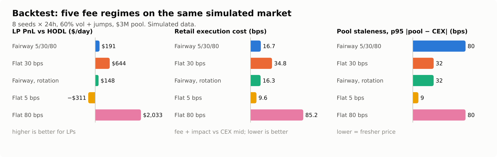
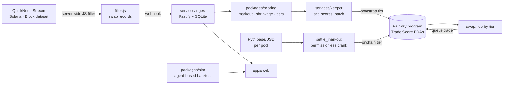
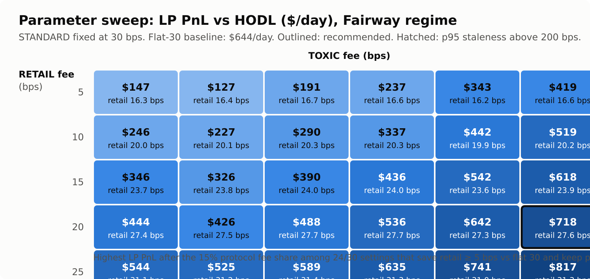

# Fairway

**A Solana DEX where bots pay more and humans pay less.**

Fairway is a constant-product AMM whose swap fee depends on the trader's **toxicity tier**. The tier is read from an onchain `TraderScore` account. A keeper writes a **bootstrap** score from the wallet's public history on all venues (via **QuickNode Streams**). For trades on Fairway itself, the **program computes the score onchain** from the wallet's own swaps and a Pyth price, with no trusted oracle.

> **Hackathon status, read this first.** Everything runs offline on **synthetic data** (a deterministic simulator and fixtures). The Anchor program is unaudited and has not been deployed to devnet yet. The Raydium SOL-USDC vault addresses in the Stream config were checked against mainnet, but no live Stream has run yet. See [What is simulated vs. live](#what-is-simulated-vs-live).

**Fairway is bot-friendly: good bots pay less, extractive flow pays its fair share.** The fee follows measured behaviour (markout), not whether the signer is a human or a program.

## For judges

**In three lines.** (1) A Solana AMM whose swap fee depends on the signer's measured toxicity tier (5 / 30 / 80 bps), so retail pays less and informed bots pay more. (2) Scores come from two sources: a keeper that backfills history through a QuickNode Stream, and the program itself, which marks every Fairway swap against Pyth and scores it onchain with no oracle operator. (3) A backtest on synthetic data shows who pays and who gains, including where it does not work (LPs vs a flat 30 bps pool; see [Backtest results](#backtest-results-synthetic)).

| Criterion | What to look at | Proof |
|---|---|---|
| Technical execution | Anchor program with PDAs, SPL vaults, checked integer math, a permissionless oracle-based settlement, a protocol treasury, rent sponsorship; 30 LiteSVM tests including the wrong-signer attack | [`programs/fairway/src/`](programs/fairway/src) ([`swap.rs`](programs/fairway/src/instructions/swap.rs), [`settle.rs`](programs/fairway/src/instructions/settle.rs), [`treasury.rs`](programs/fairway/src/instructions/treasury.rs)), [`tests/fairway.rs`](programs/fairway/tests/fairway.rs), [`crates/fairway-math/`](crates/fairway-math), shared Rust/TS test vectors [`vectors/onchain.json`](crates/fairway-math/vectors/onchain.json) |
| Product & UX | Swap page with a "same trade, two wallets" panel, wallet score explorer with "Onchain verified" and "Verified fair flow" badges, LP dashboard with protocol revenue and "extra fees from bots", interactive backtest, two pools (SOL/USDC, BONK-test/USDC), dark mode, mock mode needs no wallet | [`apps/web/app/`](apps/web/app), [`swap-panel.tsx`](apps/web/components/swap-panel.tsx), [`two-wallets.tsx`](apps/web/components/two-wallets.tsx), [`wallet-detail.tsx`](apps/web/components/wallet-detail.tsx) |
| Innovation | Fee keyed on a wallet's own measured markout (information content), scored trustlessly onchain; STANDARD floor makes wallet rotation useless; any DEX can read the score | [Scoring and trust model](#scoring-and-trust-model), [`docs/ECONOMICS.md`](docs/ECONOMICS.md), [`getFeeTier`](packages/sdk/src/feetier.ts) |
| Impact & potential | Retail execution cost down 18 bps in the backtest, LVR down 70–90%, a revenue model (15% protocol share, score licensing), honest limits | [Business model](#business-model), [Backtest](#backtest-results-synthetic), [`docs/RISKS.md`](docs/RISKS.md) |
| Demo | `pnpm demo` runs everything offline in one command; a 2–3 minute shot list | [Quick start](#quick-start), [`docs/DEMO_SCRIPT.md`](docs/DEMO_SCRIPT.md), [`docs/PITCH.md`](docs/PITCH.md) (5-minute script, 15 Q&As) |

**Per-prize requirements**

- **DeFi track**
  - [x] A new AMM fee primitive: tier-by-markout fees, [`swap.rs`](programs/fairway/src/instructions/swap.rs), [`fairway-math`](crates/fairway-math/src/tier.rs)
  - [x] Economic design: [Economic design](#economic-design) and [`docs/ECONOMICS.md`](docs/ECONOMICS.md)
  - [x] Risk assumptions: [Risk assumptions](#risk-assumptions) and [`docs/RISKS.md`](docs/RISKS.md)
  - [x] Program addresses: [Program IDs](#program-ids) (localnet ID; devnet is **not deployed yet**)
  - [x] Simulation evidence, with limits stated: [`packages/sim/`](packages/sim), [`packages/sim/out/`](packages/sim/out)
- **Best use of Solana**
  - [x] Anchor program, PDAs (`config`, `pool`, `vault`, `lp_mint`, `score`, `treasury`), SPL Token vaults and LP mint: [`state.rs`](programs/fairway/src/state.rs), [`pool.rs`](programs/fairway/src/instructions/pool.rs)
  - [x] Program IDs and a Solana-usage explanation: [Program IDs](#program-ids), [How we use Solana](#how-we-use-solana)
  - [x] Solana-native data: v0 transactions with lookup tables, token-balance deltas, Anchor events: [`packages/parser/`](packages/parser/src/core.ts)
  - [x] Onchain oracle use (Pyth `PriceUpdateV2`) and slot-based timing: [`settle.rs`](programs/fairway/src/instructions/settle.rs)
  - [ ] Devnet deployment: not done (needs the human steps in [`docs/SETUP_REMAINING.md`](docs/SETUP_REMAINING.md))
- **QuickNode Streams bounty**
  - [x] A Stream with a server-side filter and a webhook destination, config documented (network, dataset, filter logic, destination, why): [`streams/STREAM_CONFIG.md`](streams/STREAM_CONFIG.md), [QuickNode Stream configuration](#quicknode-stream-configuration)
  - [x] The filter itself, standalone and tested against `getBlock`-shaped fixtures: [`streams/filter.js`](streams/filter.js), [`streams/filter.test.ts`](streams/filter.test.ts), shared logic in [`packages/parser/`](packages/parser/src/core.ts)
  - [x] Webhook receiver with signature check, idempotent storage, scoring: [`services/ingest/`](services/ingest/src/app.ts)
  - [ ] A live Stream running: not yet created (needs a QuickNode account; steps in [`docs/SETUP_REMAINING.md`](docs/SETUP_REMAINING.md))



## The problem

- When the price moves on a centralized exchange, arbitrage bots hit the AMM at the stale price first. LPs lose that gap. This is **LVR** (loss-versus-rebalancing).
- Every trader pays the same fee, so a retail swap pays the same as a bot that is trading on information.
- A flat fee has to be high enough to protect LPs, which overcharges retail. Or it is low enough for retail, and LPs bleed.

## How it works

1. **Markout.** For each past trade we ask: did the price move in the trader's favor shortly after? `markout_bps = side × (mid(t+h) − execPrice) / execPrice × 10,000`, with `side = +1` for a buy and `−1` for a sell. We use the pre-fee price, because we measure information, not cost. The primary horizon is 30 s (5 s and 60 s are also stored).
2. **Score.** `score = Σ(notional × markout) / (Σ notional + K)`, with `K = 2,000` quote units. The shrinkage toward 0 means one lucky trade cannot move a wallet far.
3. **Tier.**

   | Tier | Rule (defaults, one config object) | Fee |
   |---|---|---|
   | `TOXIC` | score ≥ 10 bps and ≥ 5 trades | 80 bps |
   | `RETAIL` | score ≤ 3 bps, ≥ 5 trades and ≥ 3 days of history | 5 bps |
   | `STANDARD` | everyone else, **including every new wallet** | 30 bps |

4. **Onchain lookup.** The `swap` instruction derives the `TraderScore` PDA from the **signer** (`["score", trader]`). If it is missing, stale (older than `score_ttl_slots`) or malformed, the swap pays STANDARD. A bot cannot pass someone else's RETAIL account, because the seeds check fails.
5. **Onchain verified scoring.** Every Fairway swap is queued in the signer's `TraderScore` (a 4-entry buffer of `{pool, exec_price, slot, side, notional}`; the PDA is created on the first swap, with the rent sponsored by the protocol treasury when it can, else paid by the trader). After `markout_slots` (default 75 slots, about 30 s) **anyone** can call `settle_markout(trader)` for a pool. It reads that pool's Pyth price account, applies the same markout formula, shrinkage `K` and tier thresholds as `packages/scoring`, and updates the wallet's onchain tier. See [Scoring and trust model](#scoring-and-trust-model).
6. **Data layer.** A QuickNode Stream filters Solana blocks down to swaps on chosen pools. Backfill scores wallets from day one using their activity on other DEXs (Raydium SOL-USDC is configured; Orca and Meteora only need their vault addresses added), and the live stream keeps scores fresh.



## Scoring and trust model

Each `TraderScore` PDA holds two independent scores:

| | Bootstrap score | Onchain verified score |
|---|---|---|
| Written by | the keeper (`score_authority`) with `set_score` / `set_scores_batch` | the program only: `swap` queues trades, `settle_markout` scores them |
| Inputs | history on every venue, from QuickNode Streams (Raydium today) | the wallet's own swaps on pools that have a Pyth oracle (set per pool with `set_pool_oracle`; feed id, staleness ≤ 60 s and confidence ≤ 0.5% checked) |
| Horizons | 5 s / 30 s / 60 s, float, "all horizons" rule | one horizon (`markout_slots` = 75 ≈ 30 s), integer bps, primary-horizon rule |
| Expiry | TTL (`score_ttl_slots`), then STANDARD | does not expire |
| Trust | trust the keeper (it can mislabel, but cannot set fees or touch funds) | trust Pyth and the program; no operator |

**Blend rule** (`fairway_math::resolve_blended`, mirrored in the SDK as `resolveBlendedTier`): while a wallet has less than `Config.markout.onchain_min_notional` (default **1,000 USDC**) of settled onchain notional, or fewer than 5 settled trades (the tier rules' minimum), the keeper's bootstrap tier applies, exactly as before. Once it has both, **the onchain tier wins** and keeper writes no longer change that wallet's fee. `set_score` still updates the bootstrap fields, but it never touches the onchain fields. The keeper skips such wallets to save fees.

**Trust model, before and after.** Before M13, every tier came from one trusted signer. Now the keeper only seeds new wallets (and covers history Fairway cannot see onchain). Any wallet that trades meaningfully on Fairway graduates to a score that anyone can recompute from the chain, and the keeper cannot override it. A compromised keeper can no longer give an active bot RETAIL pricing.

Details that keep it hard to game:

- The trade minimum matters: without it, a bot the keeper knows is TOXIC could do 3 large flat trades, pass the notional threshold and drop to STANDARD (tested: `few_large_trades_do_not_override_a_toxic_keeper_score`).
- `settle_markout` only accepts the PDA seeded by the `trader` argument (a wrong-trader account fails `ConstraintSeeds`), and it only uses a Pyth price **posted after** each trade's horizon.
- If the 4-entry buffer is full, the new trade is not queued (`dropped_trades += 1`) and **gets no RETAIL discount**. A wallet cannot hide trades and still pay 5 bps.
- Trades not settled within `max_settle_slots` (450) expire unscored. The wallet keeps its current tier, so the worst case is STANDARD pricing for unscored flow. There is no crank reward in the MVP: LPs, the keeper and retail wallets (who want RETAIL) have the incentive to crank.
- **Same math in TypeScript and Rust:** `crates/fairway-math/src/markout.rs` and `packages/scoring/src/onchain.ts` both run on `crates/fairway-math/vectors/onchain.json` (markout signs, price conversion, shrinkage, tier boundaries). The TS suite also checks that the integer path gives the same tier as the float scorer, and a score within 1 bps.
- Prices are 1e12 fixed point (quote per base), so a $0.00002 memecoin keeps 7 significant digits. The program assumes the quote token is USD-pegged (USDC), so a base/USD Pyth feed is the mid.
- **The oracle is per pool.** A pending trade is tagged with its pool and settled only against that pool's feed (`Pool.oracle_price_account` / `oracle_feed_id`). A pool with no oracle (for example a test memecoin that has no Pyth feed) still trades and charges tiers from keeper scores, but builds no onchain evidence, creates no score account and cannot trigger the full-buffer cap. Tested: `each_pool_settles_only_against_its_own_oracle`, `pool_without_oracle_is_not_scored_onchain`.

## Business model

Retail pays less, LPs earn from flow that used to be free, the protocol takes a small cut, and the scores themselves can be licensed.

| Who | What they get | Where it shows |
|---|---|---|
| **Retail** | A lower fee (RETAIL tier, 5 bps vs a 30 bps flat fee) once their own trades show no informed edge | `/swap`, "Same trade, two wallets" |
| **Good bots** | The same fee as retail if their flow is uninformed (market makers, hedgers, rebalancers). "Verified fair flow" is earned from measured behaviour, not from being human | `/wallet/[address]` badge |
| **Extractive flow** | Pays its fair share: TOXIC tier (80 bps) for arbitrage and sniping | `/pool` headline "Extra fees earned from bots" |
| **LPs** | 85% of every swap fee, plus less LVR (arbitrage profit falls 73–90% in the sim). **Not** unconditionally more than a flat 30 bps pool: see the [verdict](#backtest-results-synthetic) | `/pool`, `/backtest` |
| **Protocol** | `Config.protocol_fee_bps` = **15%** of every swap fee (max 50%), accrued per pool and claimed into the treasury PDA by anyone | `/pool` "Protocol revenue" |
| **Other DEXes** | Read a wallet's score with one call and price flow with it. Licensing the scores (an access API and SLA, or a revenue share when another DEX routes by Fairway tiers) is the next revenue line, not built yet | [Any Solana DEX can read Fairway scores](#any-solana-dex-can-read-fairway-scores) |

**Protocol fee mechanics.** The protocol's share of each swap fee stays in the vault but is booked in `Pool.protocol_owed_*` and excluded from the reserves that price the curve and the LP shares. `claim_protocol_fees` (permissionless) moves it into token accounts owned by the treasury PDA `["treasury"]`. Only the admin can move treasury funds out (`treasury_transfer_tokens`, `treasury_withdraw_sol`).

**Sponsored score accounts.** A trader's first swap on a scored pool creates their `TraderScore` PDA (about 0.0023 SOL of rent). The treasury pays that rent when it holds more SOL than its own rent-exempt minimum plus the rent; otherwise the trader pays (fallback). The account is flagged `sponsored`, and `close_score` refunds the treasury, not the trader. The treasury is funded by anyone sending SOL to its address (the seed script sends 0.05 SOL). Treasury SOL is a cost of onboarding, so a deployment should fund it from the protocol's fee revenue.

**The cost side is real.** The protocol's 15% comes out of LP fees, so LPs net less than the pre-protocol figures; the backtest tables show both. The sweep's best setting still leaves LPs about $155/day below a flat 30 bps pool after the protocol share (±$214), and that setting needs a 200 bps toxic fee. See [`docs/ECONOMICS.md`](docs/ECONOMICS.md).

## Any Solana DEX can read Fairway scores

`TraderScore` accounts are public PDAs (`["score", wallet]`). Another AMM, an aggregator or a wallet can price flow by tier without trusting our API:

```ts
import { Connection, PublicKey } from '@solana/web3.js';
import { getFeeTier } from '@fairway/sdk';

const t = await getFeeTier(new Connection(rpcUrl), new PublicKey(wallet));
// { tier: 0|1|2, tierName: 'RETAIL'|'STANDARD'|'TOXIC', feeBps, source: 'onchain'|'score'|…,
//   verified: boolean,            // true = computed by the Fairway program from the wallet's own trades vs Pyth
//   onchain: { scoreBps, settledTrades, settledNotional } | null, isNew: boolean }
```

- **One read, no signer.** `getFeeTier` fetches `Config` and the wallet's score PDA and resolves the tier exactly as the program does (keeper bootstrap until the onchain evidence threshold, then the onchain tier; stale or missing → STANDARD; a full pending buffer removes the RETAIL discount). If you already hold the two accounts, call the pure `feeTierFromAccounts(wallet, config, score, slot)`.
- **From onchain code (CPI-free).** Derive the PDA `["score", wallet]` under the Fairway program id, check its owner, and read the `tier` / `onchain_tier` / `sum_notional` fields (layout in [`state.rs`](programs/fairway/src/state.rs) and the IDL `packages/sdk/idl/fairway.json`). The blend rule is in [`resolve_blended`](crates/fairway-math/src/tier.rs).
- **Trust.** `verified: true` means the tier comes from the program's own markout computation. Otherwise it is the keeper's bootstrap score (trusted, expires after `score_ttl_slots`).
- **Not built yet:** a hosted API, rate limits, SLAs or a revenue share. Those are the licensing line of the business model.

## What makes it unique

- The fee is keyed on **measured information content of a wallet's past flow**, not on market volatility (dynamic-fee AMMs) or on a single block's behavior. Retail is rewarded for being provably uninformed.
- **A fresh wallet can never pay less than STANDARD (30 bps).** Wallet rotation therefore gives bots no discount. We simulate that worst case explicitly.
- **Cross-venue history.** Streams lets us score a wallet from its trades on other venues (Raydium today, and any AMM whose vaults are added to the config) before it ever touches Fairway.
- **Transparent inputs.** Every score is reproducible from public swaps (the wallet explorer shows how).
- **Trustless for Fairway's own flow.** The program computes markouts onchain against Pyth, so active wallets are scored with no oracle operator (the wallet page shows "Onchain verified" vs "Bootstrap score").

## Backtest results (synthetic)

Agent-based simulation: 24 h, 60% annualized volatility, 400 ms steps, 10,000 SOL / $1.5M pool ($3M TVL), 8 seeds averaged. Retail follows Poisson arrivals with lognormal sizes (median $150). There are 3 arbitrageur wallets and 3 momentum-sniper wallets. Tiers are learned in a 72 h warm-up and then applied.

| Regime (per day, mean of 8 seeds) | LP fees | Arb profit (LVR proxy) | LP PnL vs HODL | LP PnL after 15% protocol share | Retail cost (bps) | p95 staleness (bps) |
|---|---:|---:|---:|---:|---:|---:|
| Flat 30 bps (baseline; LPs keep 100%) | $1,528 | $132 | $644 | $644 | 34.8 | 31.6 |
| Fairway 5/30/80 (demo fees) | $1,070 | $36 | $191 | $30 | **16.7** | 79.9 |
| Fairway 20/30/200 (sweep pick) | $1,529 | $13 | $718 | $489 | **27.6** | 196 |
| Fairway 5/30/80, **arbs rotate wallets** | $1,035 | $132 | $148 | −$7 | 16.3 | 31.6 |
| Flat 5 bps | $579 | $642 | −$311 | −$398 | 9.6 | 8.5 |
| Flat 80 bps | $2,903 | $35 | $2,033 | $1,597 | 85.2 | 79.8 |

"LP PnL vs HODL" is the full LP result (reserves plus fees, valued at the final CEX price, minus holding the initial reserves), so it includes arbitrage and sniper losses. "Arb profit" is measured at the CEX mid. The flat-30 baseline row has no protocol share because it is the reference pool. All numbers come from `packages/sim/out/*.json`, and `pnpm sim` regenerates them.

**Verdict on "do LPs earn more than a flat 30 bps pool, while retail pays less?" (checked 2026-11-19): not unconditionally. Read this before quoting a number.**

- **Retail pays less and bots pay more: yes.** At 5/30/80, retail saves **18 bps** (34.8 → 16.7) and arbitrage profit falls 73%. Bots pay about **$475/day** more in fees than they would at the STANDARD fee on the same volume.
- **LPs vs flat 30 depends on the schedule.** At the demo schedule 5/30/80, LPs earn **$453/day less** than in a flat-30 pool (±66). The retail discount is paid by LPs: each bp of retail saving costs roughly $20/day on this $3M pool.
- **Sweep pick 20/30/200** (best LP result after the protocol share among settings that save retail ≥ 5 bps): retail saves **7.1 bps**, arbitrage profit falls 90% (LVR check), and LP PnL is **+$74/day vs flat 30 before the protocol share (±214, not statistically different from zero) and −$155/day after the 15% share**. It needs a 200 bps toxic fee, which pushes p95 pool-vs-CEX deviation to 196 bps (flat 30: 32).
- **With the protocol's 15% share, LPs beat flat 30 only under assumptions**: retail volume rising with lower fees (elasticity ≥ 1 in the sweep below), or a retail fee close to 30. These are labeled results, not measurements.
- **The wallet-rotation worst case is the weakest point.** Rotating arbs pay STANDARD, keep their full profit ($132/day), and the pool is as accurate as flat 30. Retail still gets its discount, and LPs fund it: −$496/day vs flat 30 at 5/30/80, −$196/day at 20/30/200.

**Elasticity sensitivity (assumption, not a measurement).** Arrival rate × (1 + e·(30 − fee)/30) / (1 + e): `e = 1` means a retail wallet paying 15 bps instead of 30 trades about 33% more often. LP PnL vs flat 30 per day (before / after the 15% protocol share), 4 seeds:

| Retail elasticity | 5/30/80 | 20/30/200 |
|---|---:|---:|
| 0 (default) | −$527 / −$673 | +$127 / −$104 |
| 0.25 | −$386 / −$547 | +$184 / −$54 |
| 0.5 | −$417 / −$567 | +$132 / −$92 |
| 1 | −$293 / −$466 | +$339 / +$79 |

Informed-flow intensity matters too: with 4× the sniper activity, 20/30/200 falls to −$202/day vs flat 30. Full tables: [`docs/ECONOMICS.md`](docs/ECONOMICS.md) §4–5, files `sensitivity*.json` and `sweep-elastic.json`.

So the defensible pitch is: **retail execution cost falls, LVR falls by 70–90%, and the cost is paid by LPs (and the protocol's share) unless volume responds to the lower retail fee.** Fairway is a way to move value from bots to retail and LPs, not free money.



## Economic design

Fee tiers, shrinkage, the anti-gaming argument and how the recommended parameters were chosen are in [`docs/ECONOMICS.md`](docs/ECONOMICS.md). In short:

- Fees are charged on the input, stay in the vaults (k grows), and are tracked per tier on the `Pool` account.
- Tier fees (`[retail, standard, toxic]`) live in `Config` and can be updated by the admin. The oracle can only choose the tier, never the fee.
- Faking a RETAIL history means trading with near-zero or negative markout for at least 3 days and at least 5 trades, which is the opposite of what an arbitrageur does.

## Risk assumptions

Full list in [`docs/RISKS.md`](docs/RISKS.md). The main ones:

- **Oracle trust.** The `score_authority` can mislabel wallets that have little Fairway history. Mitigations: a TTL, public inputs, the fact that it cannot set fees or touch funds, and the onchain verified score, which overrides it after 1,000 USDC and 5 trades of settled Fairway flow. The remaining trust for active wallets is in Pyth (validated feed id, staleness, confidence).
- **Settlement liveness.** `settle_markout` is a permissionless crank with no reward yet. Unsettled trades expire after 450 slots and are not scored.
- **Wallet rotation / Sybil.** Handled by the STANDARD floor, but it also means fresh-wallet bots keep STANDARD pricing (see the results above).
- **Aggregators.** The signer is the end user, so a router does not change the tier. Bots routed through a shared router account would look like one wallet, which is not modelled.
- **Data quality.** Pre-fee prices on external venues are approximated from a configured fee.
- **Unaudited program.** Do not use real funds.

## How we use Solana

- **Anchor program** with PDAs for `Config`, `Pool`, vault token accounts, the LP mint and per-trader `TraderScore`. The score PDA is derived from the **signer**, which is the core security property.
- **SPL Token** vaults and LP mint. No floats onchain (u128 checked math, rounding in the pool's favor).
- **`set_scores_batch`** via `remaining_accounts` (up to 10 wallets per transaction) keeps oracle writes cheap thanks to Solana's low fees and fast finality.
- **Onchain markout scoring.** Slots give a precise clock for the 30 s horizon (75 slots). Pyth pull-oracle `PriceUpdateV2` accounts provide the mid. The program parses and validates them without extra dependencies. The score PDA is created on the first swap, paid by the trader (about 0.003 SOL rent, refundable by closing).
- **Anchor events** (`SwapExecuted`) let indexers and the Stream filter decode Fairway swaps exactly.
- **Solana-native data.** The parser handles v0 transactions with address lookup tables (`loadedAddresses`), pre/post token balances and failed transactions.
- Solana's 400 ms slots are why LVR is a real problem: stale-price windows are short but frequent. The simulator uses 400 ms steps.

## Program IDs

| Cluster | Program | Address |
|---|---|---|
| Localnet | `fairway` | `8jo3xry2rp9rQHwPCyh8c9Qwnw2HHa5JvAUiXHo2XPXk` (throwaway keypair in `.keys/`, gitignored) |
| Devnet | `fairway` | **TBD: fill after deploy** (see [`docs/SETUP_REMAINING.md`](docs/SETUP_REMAINING.md)) |
| Mainnet | n/a | Not deployed. The program is unaudited. |

Fresh clones do not have the program keypair. Run `anchor keys sync` to generate one and update `Anchor.toml`, `declare_id!` and the SDK default.

PDA seeds: `config`, `pool + base_mint + quote_mint`, `vault`, `lp_mint`, `score + trader`.

## QuickNode Stream configuration

Full dashboard steps are in [`streams/STREAM_CONFIG.md`](streams/STREAM_CONFIG.md).

| Setting | Value | Why |
|---|---|---|
| Network | Solana **mainnet** (history and scores) and **devnet** (Fairway pool) | Scores need real, deep history. The Fairway pool lives on devnet during the hackathon. |
| Dataset | **Block** | We need full transactions with `meta` (token balances, loaded addresses, logs). The matching is by vault token accounts, so it works for any AMM and for aggregator-routed swaps. |
| Filter | `streams/filter.js`: for each successful tx, build the full account list (including ALT-loaded addresses), compute vault deltas for configured pools, classify buy/sell, and emit compact swap records. Returns `null` if nothing matched. | Server-side filtering means the webhook only receives swaps (KBs), not blocks (MBs). |
| Destination | **Webhook** → `https://<host>/streams/solana`, HMAC-verified (`QN_STREAM_TOKEN`) | The ingest service is idempotent on `(sig, pool)`, so retries and reorgs are safe. |
| Start | Backfill 3–7 days, then live | The RETAIL rule requires ≥ 3 days of history. |

The filter is generated from the same TypeScript the ingest service uses (`packages/parser`), and a test fails if they drift.

## Quick start

```bash
corepack enable
pnpm i
pnpm demo            # offline: fixtures → sim → ingest (fixture mode) → web (mock mode)
# open http://localhost:3000
```

Pages: `/` landing · `/swap` (persona switcher: Retail Rita, New wallet, Arb Bot 7) · `/wallet/[address]` · `/pool` · `/backtest` (interactive sweep) · `/how-it-works`.

Other commands:

```bash
pnpm test           # TS tests (vitest) + Rust tests (cargo)
pnpm build
pnpm lint
pnpm sim            # regenerate packages/sim/out/*.json (add --quick via the sim package for a fast run)
pnpm charts         # regenerate docs/charts/*.svg|png
pnpm demo:local     # local validator + deploy + seed + keeper + web in live mode (needs Solana + Anchor)
pnpm seed:devnet    # create the pool on devnet (needs funded throwaway keys; see SETUP_REMAINING)
pnpm --filter @fairway/sim replay -- --input swaps.jsonl   # historical replay on exported swaps
```

The program's tests use LiteSVM: `anchor build && cargo test -p fairway`. The wrong-signer test is `wrong_signer_cannot_use_someone_elses_retail_score` in `programs/fairway/tests/fairway.rs`. Onchain scoring tests: `markout_sign_buy_and_sell`, `shrinkage_tier_transitions_and_blend_with_keeper`, `uninformed_flow_earns_retail_onchain`, `stale_and_invalid_oracle_rejected`, `settle_before_markout_slots_does_nothing`, `wrong_trader_account_rejected`, `ring_buffer_full_drops_trade_and_removes_discount`, `unsettled_trades_expire`, `few_large_trades_do_not_override_a_toxic_keeper_score`, `authority_cannot_close_a_score_with_onchain_evidence`. Shared TS/Rust vectors: `cargo test -p fairway-math --test onchain_vectors` and `packages/scoring/test/onchain.test.ts`.

## What is simulated vs. live

| Component | Status |
|---|---|
| Backtest, sweep, charts, fixtures | **Synthetic.** Generated from a seeded simulator. The UI shows a "Simulated data" badge in mock mode. |
| Frontend (default) | **Mock mode**: reads fixtures and sim outputs. No wallet or RPC. |
| Frontend (live mode) | Real wallet adapter + SDK against a local validator (`pnpm demo:local`). Devnet is untested until the human deploys. |
| Anchor program | Real, tested with LiteSVM. **Not deployed to devnet**, unaudited. |
| Ingest, scoring, keeper | Real code. Run on fixtures in `DATA_MODE=fixture`. The keeper defaults to `dry-run`. |
| QuickNode Stream | **Config and filter are real and tested against getBlock-shaped fixtures.** No live Stream has been created yet. |
| Mid prices | Fixture mode uses the simulated CEX path. Live mode uses the pool-implied mid. `PythMidPrice` (offchain) is a stub. |
| Onchain markout scoring | **Real program code, tested in LiteSVM with a mock Pyth account.** In mock mode the wallet page computes the "Onchain verified" score from the wallet's fixture trades on both Fairway pools, with the same integer math. The devnet Pyth SOL/USD account in the seed script is **not verified yet** (see SETUP_REMAINING). BONK-test has no real price feed: in mock mode its score uses the fixture CEX path as if a BONK/USD feed existed; live, that pool would have no oracle. |
| Second pool (BONK-test / USDC) | **Synthetic and additive.** A TEST mint (not the real BONK) with its own seeded price path, generated separately in `packages/fixtures/data/memecoin.json` so the SOL-USDC fixtures are unchanged. Snipers reach TOXIC after 5–9 settled trades there; on SOL/USDC the sniper persona stays STANDARD after 3. |
| Protocol revenue, bot extra fees, retail saved (`/pool`) | **Fixture replay.** Fees recomputed from the fixture swaps at the fee they paid, volume held fixed. Treasury rent sponsorship is a count of wallets × about 0.0023 SOL. |
| Raydium vault addresses | **Real.** Checked on mainnet with `getAccountInfo` (2026-11-19): a wSOL and a USDC token account owned by the Raydium AMM v4 authority. The Orca and Fairway entries are placeholders. |

## Repo map

```
programs/fairway/     Anchor program (+ LiteSVM tests)       crates/fairway-math/   pure Rust AMM + LP math
packages/scoring/     markout, shrinkage, tiers (+ onchain.ts) packages/sim/          agent-based sim, sweep, replay
packages/parser/      block → swap records                    packages/fixtures/     deterministic synthetic data
packages/sdk/         TS client (PDAs, ixs, decoders)         streams/               filter.js + STREAM_CONFIG.md
services/ingest/      Streams webhook → SQLite (Postgres-compatible SQL)
services/keeper/      DB tiers → set_scores_batch (dry-run/local/devnet)
apps/web/             Next.js frontend                        scripts/               demo, seed, charts
docs/                 ARCHITECTURE, ECONOMICS, RISKS, PITCH, DEMO_SCRIPT, SETUP_REMAINING
```

Storage is SQLite (`better-sqlite3`). The SQL uses `ON CONFLICT` upserts and standard types, so it ports to Postgres.

## Built with

| Layer | Tools |
|---|---|
| **Sponsor: QuickNode** | **Streams** (Solana, Block dataset, server-side JS filter `streams/filter.js`, webhook destination with HMAC verification). It is the only onchain data source, used for backfill, live scoring and replay. |
| **Sponsor: Solana** | Anchor 1.2 program (PDAs, SPL Token vaults and LP mint, Anchor events, `remaining_accounts` batching), LiteSVM tests, `@solana/web3.js` 1.99, Solana wallet adapter (Wallet Standard) |
| Onchain math | Pure Rust crate `fairway-math` (u128 checked math, property-style tests) |
| Data and services | TypeScript (strict), Fastify 5, better-sqlite3, esbuild (inlines the parser into the Stream filter), vitest |
| Frontend | Next.js 16 (App Router), React 19, Tailwind CSS 4, Recharts |
| Research | Seeded agent-based simulator (GBM + jumps, retail / arb / sniper agents), parameter sweep, historical replay |

## What's next

1. **Go live on devnet:** deploy the program, run the mainnet backfill Stream on Raydium SOL-USDC, and let the keeper write real tiers (steps in [`docs/SETUP_REMAINING.md`](docs/SETUP_REMAINING.md)).
2. **More venues:** add Orca Whirlpool and Meteora DLMM vaults to the Stream config. The filter matches vaults, so no code change is needed.
3. **Better mids:** replace the pool-implied mid with Pyth (`PythMidPrice` is already behind the same interface) for cleaner markouts on real data.
4. **Trust-minimized bootstrap:** onchain scoring already covers Fairway's own flow. For cross-venue history: multiple score authorities with a quorum, a bonded oracle, and eventually ZK proofs of the score computation over a committed swap history ([`docs/RISKS.md`](docs/RISKS.md)). Also a small crank reward for `settle_markout`, paid from protocol fees.
5. **Sleeper defenses:** per-wallet notional caps on the RETAIL fee, and faster downgrades.
6. **Close the LP gap vs. flat 30 bps:** explore a dynamic STANDARD fee and volatility-scaled toxic fees in the simulator, with fee-elastic retail calibrated on real data.
7. **Audit and fuzzing** before any mainnet deployment.
