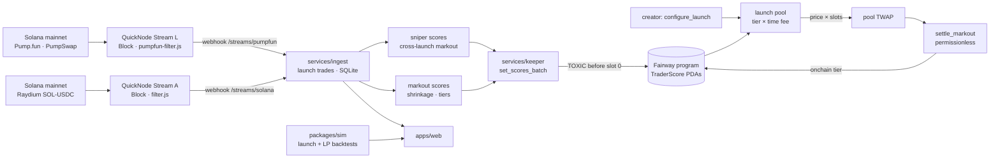
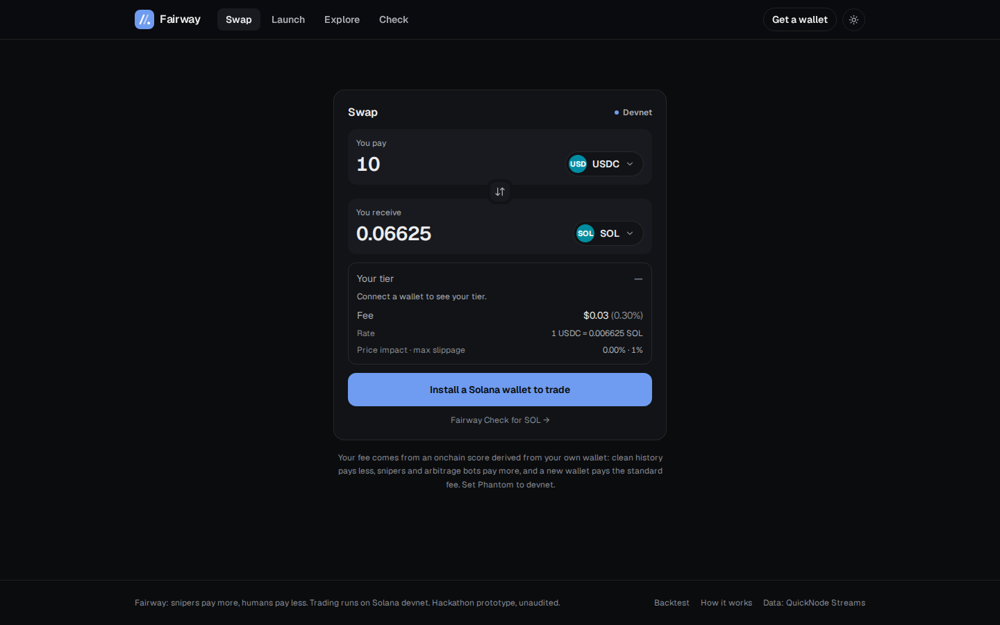
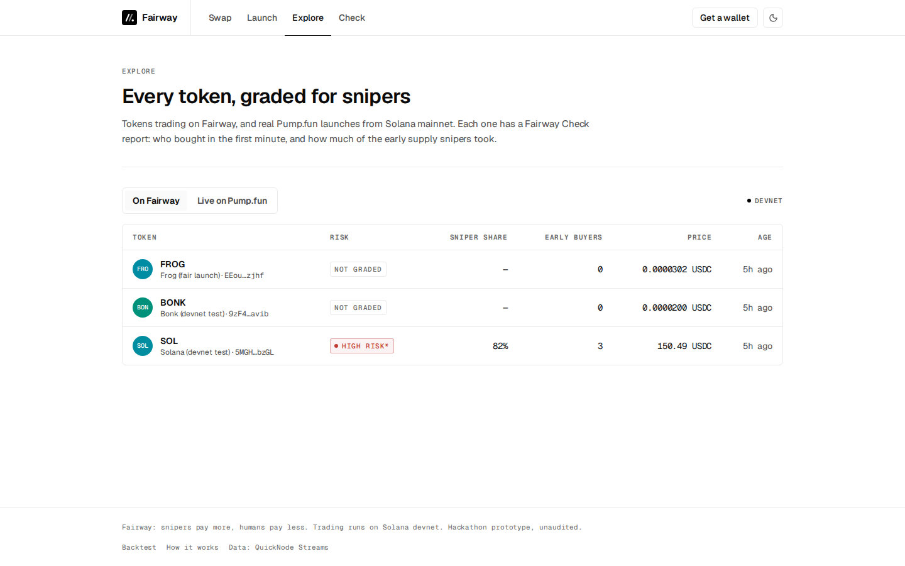
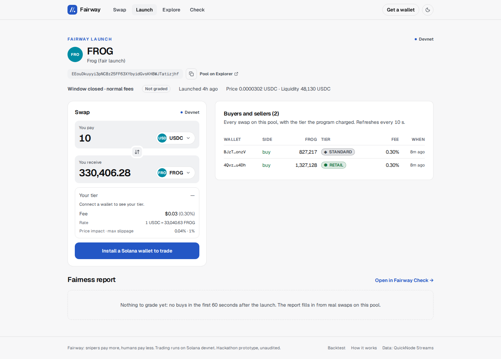

# Fairway

**Other launchpads tax everyone who's early. Fairway taxes snipers.**

A Solana launch pool whose fee depends on **who** is buying, not only **when**. Wallets with a record of sniping past launches pay more, wallets with a record of normal trading pay less, and the fee is enforced by an Anchor program.

[**▶ Live app**](https://fairway1.vercel.app) · [**🎬 Demo video**](<VIDEO_URL>) · [**Program on Solana Explorer (devnet)**](https://explorer.solana.com/address/8jo3xry2rp9rQHwPCyh8c9Qwnw2HHa5JvAUiXHo2XPXk?cluster=devnet)

## TL;DR

- **Problem.** On a new token, bots buy in the first block and sell to the humans who arrive seconds later. The usual fix, a time-decaying "anti-sniper" fee, charges the first human the same as the bot.
- **Solution.** Each tier gets its own launch fee curve (known sniper **1000 → 80 bps**, unknown or fresh wallet **300 → 30**, proven human **30 → 5**, over about 5 minutes). The tier is read from a `TraderScore` PDA derived from the **signer**, so nobody can borrow someone else's score.
- **Real data.** A QuickNode Stream on Solana mainnet, running our filter, captured **359,362 Pump.fun/PumpSwap trades** plus LetsBonk (LaunchLab), Meteora DBC and Raydium activity on 2026-11-20 ([breakdown](#real-mainnet-data-captured-2026-11-20)).
- **Deployed.** The program is live on devnet at [`8jo3xry2…XPXk`](https://explorer.solana.com/address/8jo3xry2rp9rQHwPCyh8c9Qwnw2HHa5JvAUiXHo2XPXk?cluster=devnet) with seeded pools, and **49 LiteSVM program tests** pass, including the wrong-signer attack.
- **Why it matters.** In a 200-launch simulation, Fairway charges **humans 53% less** than a time-decay fee, and the **sniper share of early supply falls from 49% to 27%**. Those numbers are simulated, and the limits are stated [below](#honest-limitations).

## Why this matters

Token launches on Solana are won by bots. A sniper buys in the first block, before any person can react, and sells into the crowd that follows. In our flat-fee simulation, snipers take **54% of the supply** sold in the first 5 minutes.

Today's defense is a fee that starts high and decays to normal. It works on everyone the same way: the sniper and the human who bought one second later both pay it. In the simulation, humans pay **~200 bps** in the launch window to stop bots that just pay it too. A stronger curve (1000 → 30) does stop snipers, but it charges humans **641 bps**.

The information to do better is public. Snipers are repeat players: the same wallets buy in the first seconds of launch after launch, and that history is onchain.

## How Fairway is different

The approaches below are described generically.

| | Flat fee | Time-decay anti-sniper fee | Token checker (shows holders) | **Fairway** |
|---|:-:|:-:|:-:|:-:|
| Protects buyers at launch | ❌ | ✅ (by taxing everyone) | ❌ (information only) | ✅ |
| Humans pay low fees from block 0 | ✅ (but no protection) | ❌ | n/a | ✅ (RETAIL curve starts at 30 bps) |
| Fresh wallets can't dodge into a discount | n/a | n/a | n/a | ✅ (fresh wallets pay the STANDARD curve, never less) |
| Enforced onchain | ✅ | ✅ | ❌ | ✅ ([`swap.rs`](programs/fairway/src/instructions/swap.rs)) |
| Rates Solana tokens it didn't launch | ❌ | ❌ | ✅ | ✅ for Pump.fun, PumpSwap, LaunchLab and Meteora DBC, SOL-quoted only ([Fairway Check](#fairway-check)) |
| Uses the wallet's track record | ❌ | ❌ | ❌ | ✅ (cross-launch markout, [`sniper.ts`](packages/scoring/src/sniper.ts)) |

A fresh-wallet sniper isn't caught. It pays exactly the time-decay curve, which is the floor. Rotating wallets removes the surcharge but never earns the discount.

## Judging criteria

| Criterion | Our answer | Proof |
|---|---|---|
| **Technical execution** | An Anchor program with a per-tier launch fee curve on slots, an onchain price × slots TWAP in the pool account, permissionless markout settlement against Pyth or the TWAP, and signer-derived score PDAs. **49 LiteSVM tests**. The Stream filters are generated from the same parser the ingest service runs, and tests fail if they drift. | [`launch.rs`](programs/fairway/src/instructions/launch.rs), [`swap.rs`](programs/fairway/src/instructions/swap.rs), [`settle.rs`](programs/fairway/src/instructions/settle.rs), [`fairway-math/launch.rs`](crates/fairway-math/src/launch.rs), [`twap.rs`](crates/fairway-math/src/twap.rs), [`tests/fairway.rs`](programs/fairway/tests/fairway.rs) |
| **Product & UX** | Swap with a token picker that shows your tier, the reason and your fee in $. A launch feed with a 3-transaction "Create token" wizard. Launch pages with buyers and their tiers. Fairway Check reports for any covered token. The default experience reads devnet data. | [Live app](https://fairway1.vercel.app), [screenshots](#screenshots), [`apps/web/`](apps/web) |
| **Innovation** | The launch fee keys on the **wallet's history across past launches**, found by a Stream before the token exists. Tokens with no oracle are scored onchain against the pool's own TWAP, measured after the trade's own price impact. | [How it works](#how-it-works), [`sniper.ts`](packages/scoring/src/sniper.ts), [`docs/ECONOMICS.md` §8](docs/ECONOMICS.md#8-launch-economics-m16) |
| **Impact & potential** | Simulated: humans pay 53% less than under time-decay, and the sniper share falls from 49% to 27%. Revenue: a 0.05 SOL launch fee plus 15% of the toxic premium. The scores are public PDAs that any DEX can read with one call. | [Launch economics](#simulated-results), [`docs/RISKS.md`](docs/RISKS.md), [`getFeeTier`](packages/sdk/src/feetier.ts) |
| **Demo** | `pnpm demo` runs everything offline in one command, and the live app runs on devnet. There is a shot-by-shot video script and a 5-minute pitch with Q&A. | [Demo video](<VIDEO_URL>), [`docs/DEMO_SCRIPT.md`](docs/DEMO_SCRIPT.md), [`docs/PITCH.md`](docs/PITCH.md) |

## Prize checklists

**DeFi track**
- ✅ New fee primitive: launch fee = f(trader tier, slots since launch), in [`configure_launch`](programs/fairway/src/instructions/launch.rs) and [`swap.rs`](programs/fairway/src/instructions/swap.rs)
- ✅ Price discovery without an oracle: the pool's TWAP is the markout reference ([`twap.rs`](crates/fairway-math/src/twap.rs), [`settle.rs`](programs/fairway/src/instructions/settle.rs))
- ✅ Economic design: [`docs/ECONOMICS.md`](docs/ECONOMICS.md)
- ✅ Risk assumptions: [`docs/RISKS.md`](docs/RISKS.md) (TWAP manipulation, launch Sybils, bundlers, oracle trust)
- ✅ Program addresses: [Addresses](#addresses)
- ✅ Simulation evidence with its limits stated: [`packages/sim/src/launch.ts`](packages/sim/src/launch.ts), [`packages/sim/out/launch.json`](packages/sim/out/launch.json)

**Best use of Solana**
- ✅ Anchor program with PDAs (`config`, `pool`, `vault`, `lp_mint`, `score`, `treasury`), SPL Token vaults and an LP mint ([`state.rs`](programs/fairway/src/state.rs), [`pool.rs`](programs/fairway/src/instructions/pool.rs))
- ✅ Slot-native design: the launch curve and the TWAP run on 400 ms slots, and the TWAP (64 observations) is updated in place in the pool account
- ✅ Solana-native data: v0 transactions with lookup tables, token-balance and lamport deltas, and Anchor events (`SwapExecuted`, `LaunchConfigured`) in [`packages/parser/`](packages/parser/src)
- ✅ How Solana is used: [How we use Solana](#how-we-use-solana)
- ✅ Devnet deployment: [`8jo3xry2rp9rQHwPCyh8c9Qwnw2HHa5JvAUiXHo2XPXk`](https://explorer.solana.com/address/8jo3xry2rp9rQHwPCyh8c9Qwnw2HHa5JvAUiXHo2XPXk?cluster=devnet)

**QuickNode Streams**
- ✅ **Network:** Solana mainnet (launch history and scores). Devnet hosts the Fairway pool.
- ✅ **Dataset:** Block, because the filters need full transactions with `meta` (token balances, loaded addresses, logs)
- ✅ **Filter logic:** [`streams/launch-filter.js`](streams/launch-filter.js) (same file as [`pumpfun-filter.js`](streams/pumpfun-filter.js)) matches transactions by launch program ID and extracts creates, buys and sells plus SOL fundings of brand-new wallets (for bundle detection). [`streams/filter.js`](streams/filter.js) extracts liquid-pair swaps by vault deltas. See [filter logic](streams/STREAM_CONFIG.md#filter-logic-per-transaction).
- ✅ **Destination:** a webhook to the ingest service (`POST /streams/solana`, token-verified, idempotent on `(sig, pool)`): [`services/ingest/`](services/ingest/src/app.ts)
- ✅ **Why:** launches can't be configured in advance, so the filter matches program IDs. Filtering on the server means the webhook receives KBs of trades instead of MBs of blocks. [Why Streams vs. polling RPC](streams/STREAM_CONFIG.md#why-streams-vs-polling-rpc)
- ✅ Running live: verified on 2026-11-20, with deliveries about once a second and the newest stored trade ~12 slots (~5 s) behind the mainnet tip
- ✅ Tested: [`streams/pumpfun-filter.test.ts`](streams/pumpfun-filter.test.ts), [`streams/filter.test.ts`](streams/filter.test.ts). Full dashboard steps: [`streams/STREAM_CONFIG.md`](streams/STREAM_CONFIG.md)

## How it works

1. **Stream → filter.** A QuickNode Stream runs our filter over every mainnet block and sends launch trades and new-wallet fundings to the ingest webhook.
2. **Scoring.** Each early buy is marked against the token's price shortly after (its **markout**). Scores are shrunk toward 0, so one lucky trade can't move a wallet far: `score = Σ(notional × markout) / (Σ notional + K)`. A wallet that sniped **≥ 3 different launches** with a shrunk score **≥ 500 bps** is TOXIC. Fresh wallets are STANDARD. Fresh wallets funded by one source shortly before a launch are flagged as a bundle (TOXIC when the funder is a known bundler). Code: [`sniper.ts`](packages/scoring/src/sniper.ts), [`bundle.ts`](packages/scoring/src/bundle.ts).
3. **TraderScore PDA.** The keeper writes tiers onchain with `set_scores_batch`, before the token exists. `swap` derives the PDA `["score", signer]`, and a missing, stale or malformed score means STANDARD.
4. **Tier × time fee.** During the launch window (default 750 slots ≈ 5 min) each tier's fee decays linearly: `fee = end + ⌈(start − end) × (window − elapsed) / window⌉`. After launch, anyone can call `settle_markout`, which scores each trade onchain against Pyth or, for a new token, the pool's own 25-slot TWAP ending 75 slots after the trade. Active wallets graduate to a score that anyone can recompute from the chain.

| Tier | Who | Slot 0 | Halfway | After the window |
|---|---|---:|---:|---:|
| TOXIC | known snipers (from past launches) | 1000 bps | 540 | 80 |
| STANDARD | every unscored wallet, **including every fresh wallet** | 300 bps | 165 | 30 |
| RETAIL | wallets with proven uninformed history | 30 bps | 18 | 30 minus the bot-tax rebate (floor 5) |



More detail: [`docs/ARCHITECTURE.md`](docs/ARCHITECTURE.md), [`docs/ECONOMICS.md`](docs/ECONOMICS.md).

### Fairway Check

Paste a token mint at `/check` to get a fairness report: who bought in the first 60 seconds, the sniper share of early supply, the share of brand-new wallets, and how much has already been dumped. The grade is **High** if snipers hold ≥ 30% of early supply (or ≥ 15% with at least half dumped), **Medium** from 10%, and **Low** below that ([`ECONOMICS.md` §9](docs/ECONOMICS.md#9-fairway-check-the-token-report)). It uses the same Stream data and the same sniper scores that set Fairway's launch fees.

## Proof

### Real mainnet data (captured 2026-11-20)

These counts come from the ingest DB at the final snapshot: about 47 minutes of mainnet data from the live Stream plus two QuickNode-RPC backfills through the same filter files.

| Venue | Program | Records |
|---|---|---|
| Pump.fun / PumpSwap | `6EF8rrecthR5Dkzon8Nwu78hRvfCKubJ14M5uBEwF6P`, `pAMMBay6oceH9fJKBRHGP5D4bD4sWpmSwMn52FMfXEA` | 359,362 trades (235,511 buys, 123,851 sells), 380 launches with a captured create, 3,633 tokens seen |
| LetsBonk (Raydium LaunchLab) | `LanMV9sAd7wArD4vJFi2qDdfnVhFxYSUg6eADduJ3uj` | 369 trades, 6 launches with a captured create, 18 tokens seen |
| Bags / Jupiter Studio / Believe (Meteora DBC) | `dbcij3LWUppWqq96dh6gJWwBifmcGfLSB5D4DuSMaqN` | 896 trades, 27 launches with a captured create, 54 tokens seen |
| Raydium AMM v4 SOL-USDC | `58oQChx4yWmvKdwLLZzBi4ChoCc2fqCUWBkwMihLYQo2` | 399 swaps by 177 wallets |

**Tokens rated:** the app's snapshot ([`apps/web/data/real-snapshot.json`](apps/web/data/real-snapshot.json)) holds 60 real launches (Pump.fun 39, Meteora DBC 15, LaunchLab 6), graded 17 High, 12 Medium and 31 Low. The grade thresholds are not calibrated on real launches.

### Simulated results

These come from 200 seeded synthetic launches ([`packages/sim/src/launch.ts`](packages/sim/src/launch.ts)), compared with a time-decay fee of 300 → 30 bps for everyone:

| Regime (means per launch) | Human fee | Sniper share of early supply | Sniper profit | Creator (LP) fees |
|---|---:|---:|---:|---:|
| Flat 30 bps (no protection) | 30 bps | 54% | $6,918 | $220 |
| Time-decay 300 → 30, everyone | 200 bps | 49% | $5,325 | $1,399 |
| Aggressive time-decay 1000 → 30 | 641 bps | 1% | $71 | $1,458 |
| **Fairway, tier × time** | **94 bps** | **27%** | **$2,432** | $591 |
| Fairway + bundle detection (60% detection rate assumed) | 94 bps | 21% | $1,734 | $494 |
| Fairway worst case: every sniper on a fresh wallet | 94 bps | 49% | $5,346 | $1,156 |

- **Humans pay 53% less** in the launch window (201 → 94 bps, paired across the same launches), and less in every one of the 200 launches.
- **The sniper share of early supply falls from 49% to 27%.** Snipers pay about the same in total (1.01×) because of deterrence: at a 10% fee in block 0, most known snipers skip the launch.
- **Liquid pair (SOL/USDC, secondary evidence):** LVR falls **73%** with LPs **neutral within noise** (16 paired seeds). [Details](docs/ECONOMICS.md#4-lp-first-results-the-default).


### Program tests

**49 LiteSVM tests** in [`programs/fairway/tests/fairway.rs`](programs/fairway/tests/fairway.rs), including `wrong_signer_cannot_use_someone_elses_retail_score`, `wrong_signer_attack_is_still_blocked_during_a_launch`, `block_zero_fees_per_tier_and_a_fresh_wallet_pays_standard_curve`, `swaps_before_the_launch_slot_are_refused`, `launch_pool_without_oracle_scores_against_its_twap` and `few_large_trades_do_not_override_a_toxic_keeper_score`. TypeScript and Rust share test vectors for the onchain math ([`crates/fairway-math/vectors/onchain.json`](crates/fairway-math/vectors/onchain.json)).

### Screenshots

| | |
|---|---|
|  |  |
|  |  |

*The screenshots show real devnet data (badge: "Devnet"). Simulated data appears only behind `?demo=1` and on `/backtest`, with a "Simulated data" badge.*

## Verify it yourself in 2 minutes

1. **Onchain:** open the [program on Solana Explorer (devnet)](https://explorer.solana.com/address/8jo3xry2rp9rQHwPCyh8c9Qwnw2HHa5JvAUiXHo2XPXk?cluster=devnet) and the [SOL/USDC pool account](https://explorer.solana.com/address/Hgodc8z2rmsyrcmcJUovZiwtSLh3V93VyEwbLrW3mTTj?cluster=devnet).
2. **Live app:** open [`/explore`](https://fairway1.vercel.app/explore) → "Live launches" for real mainnet reports, [`/check`](https://fairway1.vercel.app/check) for a token report, [`/swap`](https://fairway1.vercel.app/swap) for your tier and fee, and [`/backtest`](https://fairway1.vercel.app/backtest) for the simulation.
3. **Locally:**
   ```bash
   corepack enable && pnpm i && pnpm test   # TS (vitest) + Rust (cargo) tests
   pnpm demo                                # fully offline at http://localhost:3000
   ```

## Honest limitations

- **Fresh-wallet snipers** pay the STANDARD curve, which is the same as time-decay. Fairway can't price a sniper it has never seen.
- **Creators earn less fee income** than under time-decay ($591 vs $1,399 per simulated launch), because time-decay income is mostly paid by humans.
- **The headline results are simulated.** The real data is under an hour of mainnet history, so the known-sniper list is short and the Check grades are uncalibrated. LaunchLab and Meteora DBC are a coverage demo with few launches.
- **The bundle detection rate (60%) is an assumption.** Funding through an exchange or extra hops is not linked.
- **TWAP manipulation** is possible at a cost in price impact ([`RISKS.md` §1d](docs/RISKS.md)). The keeper is trusted for wallets with little Fairway history.
- **Liquid pair:** LPs are not proven better off than in a flat 30 bps pool (−$56 ± 31/day after the protocol share).
- **The program is unaudited** and devnet only. The Phantom click path has not been tested in a browser.

## What's next

1. Run the Stream over several days of launch history so the keeper writes a larger real known-sniper set.
2. Jupiter integration: routers read the signer's `TraderScore` with one account read ([`getFeeTier`](packages/sdk/src/feetier.ts)) before quoting.
3. Launchpad partnerships: tokens that graduate from a bonding curve land in a Fairway pool with a launch curve.
4. Scores as a service: a hosted API and SLA for any DEX, launchpad or wallet.
5. Deeper bundler detection: multi-hop funding graphs and exchange-withdrawal clustering.
6. ZK proofs of trading history to replace the trust in the bootstrap keeper.
7. Audit and fuzzing before any mainnet deployment.

## How we use Solana

- **A launch curve on slots.** `swap` computes the decayed fee from `Clock::slot` with integer math, and 400 ms slots give a precise clock for "the first seconds of a launch".
- **An onchain TWAP** in the pool account (64 observations, updated in place within the 4 KB SBF stack), so tokens with no oracle are still scored trustlessly.
- **Signer-derived PDAs** (`["score", trader]`) are the core security property. SPL Token vaults and LP mint, u128 checked math, no floats.
- **Pyth `PriceUpdateV2`** accounts are validated in the program (feed id, staleness ≤ 60 s, confidence ≤ 0.5%) for pools that have an oracle.
- **Cheap batch writes:** `set_scores_batch` writes up to 10 wallets per transaction through `remaining_accounts`.
- **Native data:** lamport deltas on bonding curves, WSOL vault deltas, ALT-loaded accounts and Anchor events.

## Addresses

| Item | Address |
|---|---|
| Fairway program (devnet and localnet) | [`8jo3xry2rp9rQHwPCyh8c9Qwnw2HHa5JvAUiXHo2XPXk`](https://explorer.solana.com/address/8jo3xry2rp9rQHwPCyh8c9Qwnw2HHa5JvAUiXHo2XPXk?cluster=devnet) |
| Config PDA (devnet) | `5J5oibtSnpDUv54tD7tkpoxZsB2XhNRZCsrvrJPJCmke` |
| SOL/USDC pool (devnet) | `Hgodc8z2rmsyrcmcJUovZiwtSLh3V93VyEwbLrW3mTTj` |
| Treasury PDA (devnet) | `AAaHF33drVN2vCcgdrm55hCUwwVH5xysDWzqnARxAUwi` |
| Pyth SOL/USD (devnet, verified 2026-11-19) | `7UVimffxr9ow1uXYxsr4LHAcV58mLzhmwaeKvJ1pjLiE` |
| Mainnet | Not deployed (unaudited) |

PDA seeds: `config`, `pool + base_mint + quote_mint`, `vault`, `lp_mint`, `score + trader`, `treasury`. A fresh clone has no program keypair: run `anchor keys sync` before your own deploy.

## Quick start

```bash
corepack enable
pnpm i
pnpm demo            # offline: fixtures → sim → ingest (fixture mode) → web (mock mode)

pnpm test            # all TS + Rust tests
pnpm build && pnpm lint
anchor build && cargo test -p fairway   # 49 LiteSVM program tests
pnpm demo:local      # local validator + deploy + seed + live mode (needs Solana + Anchor)
pnpm seed:devnet     # idempotent devnet seed, writes scripts/out/devnet-seed.json
```

The remaining setup steps that need accounts (Stream, tunnel, keeper on devnet) are in [`docs/SETUP_REMAINING.md`](docs/SETUP_REMAINING.md).

## Repo map

```
programs/fairway/     Anchor program (+ LiteSVM tests)        crates/fairway-math/   pure Rust AMM, launch, TWAP, markout math
packages/scoring/     markout, shrinkage, tiers, snipers       packages/sim/          agent-based sim, launch sim, sweep, replay
packages/parser/      block → swap / launch records            packages/fixtures/     deterministic synthetic data
packages/sdk/         TS client (PDAs, ixs, decoders, getFeeTier)
streams/              launch-filter.js, filter.js, STREAM_CONFIG.md
services/ingest/      Streams webhook → SQLite (Postgres-compatible SQL)
services/keeper/      DB tiers → set_scores_batch (dry-run / local / devnet)
apps/web/             Next.js frontend                          scripts/               demo, seed, capture, charts
docs/                 ARCHITECTURE, ECONOMICS, RISKS, PITCH, DEMO_SCRIPT, SETUP_REMAINING
```

## Built with

| Layer | Tools |
|---|---|
| **QuickNode** | Streams (Solana mainnet, Block dataset, server-side JS filters, webhook destination) as the onchain data source. QuickNode RPC for the backfill and the live app's server-side lookups. Endpoints stay in gitignored env files. |
| **Solana** | Anchor 1.2, SPL Token, PDAs, Anchor events, LiteSVM, `@solana/web3.js`, Wallet Standard wallet adapter, Pyth pull oracle |
| Services | TypeScript (strict), Fastify 5, better-sqlite3, esbuild, vitest |
| Frontend | Next.js 16, React 19, Tailwind CSS 4, Recharts |
| Research | Seeded agent-based simulator, parameter sweep, historical replay |
