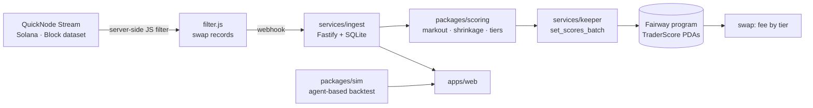

# Fairway

**A Solana DEX where bots pay more and humans pay less.**

Fairway is a constant-product AMM whose swap fee depends on the trader's **toxicity tier**. The tier is read from an onchain `TraderScore` account, and a score oracle writes that account from the wallet's public trading history. The history comes from **QuickNode Streams**.

> **Hackathon status, read this first.** Everything runs offline on **synthetic data** (a deterministic simulator and fixtures). The Anchor program is unaudited and has not been deployed to devnet yet. Raydium vault addresses in the Stream config are marked VERIFY. See [What is simulated vs. live](#what-is-simulated-vs-live).


## The problem

- When the price moves on a centralized exchange, arbitrage bots hit the AMM at the stale price first. LPs lose that gap. This is **LVR** (loss-versus-rebalancing).
- Every trader pays the same fee, so a retail swap pays the same as a bot that is trading on information.
- A flat fee has to be high enough to protect LPs, which overcharges retail. Or it is low enough for retail, and LPs bleed.

## How it works

1. **Markout.** For each past trade we ask: did the price move in the trader's favor shortly after? `markout_bps = side × (mid(t+h) − execPrice) / execPrice × 10,000`, with `side = +1` for a buy and `−1` for a sell. We use the pre-fee price, because we measure information, not cost. The primary horizon is 30 s (5 s and 60 s are also stored).
2. **Score.** `score = Σ(notional × markout) / (Σ notional + K)`, with `K = 2,000` quote units. The shrinkage toward 0 means one lucky trade cannot move a wallet far.
3. **Tier.**

   | Tier | Rule (defaults, one config object) | Fee |
   |---|---|---|
   | `TOXIC` | score ≥ 10 bps and ≥ 5 trades | 80 bps |
   | `RETAIL` | score ≤ 3 bps, ≥ 5 trades and ≥ 3 days of history | 5 bps |
   | `STANDARD` | everyone else, **including every new wallet** | 30 bps |

4. **Onchain.** The `swap` instruction derives the `TraderScore` PDA from the **signer** (`["score", trader]`). If it is missing, stale (older than `score_ttl_slots`) or malformed, the swap pays STANDARD. A bot cannot pass someone else's RETAIL account, because the seeds check fails.
5. **Data layer.** A QuickNode Stream filters Solana blocks down to swaps on chosen pools. Backfill scores wallets from day one using their activity on Raydium, Orca and Meteora, and the live stream keeps scores fresh.



## What makes it unique

- The fee is keyed on **measured information content of a wallet's past flow**, not on market volatility (dynamic-fee AMMs) or on a single block's behavior. Retail is rewarded for being provably uninformed.
- **A fresh wallet can never pay less than STANDARD (30 bps).** Wallet rotation therefore gives bots no discount. We simulate that worst case explicitly.
- **Cross-venue history.** Streams lets us score a wallet from its Raydium/Orca/Meteora trades before it ever touches Fairway.
- **Transparent inputs.** Every score is reproducible from public swaps (the wallet explorer shows how).

## Backtest results (synthetic)

Agent-based simulation: 24 h, 60% annualized volatility, 400 ms steps, 10,000 SOL / $1.5M pool ($3M TVL), 8 seeds averaged. Retail follows Poisson arrivals with lognormal sizes (median $150). There are 3 arbitrageur wallets and 3 momentum-sniper wallets. Tiers are learned in a 72 h warm-up and then applied.

| Regime (per day, mean of 8 seeds) | LP fees | Arb profit | LP fees − arb profit | Retail cost (bps) | p95 staleness (bps) |
|---|---:|---:|---:|---:|---:|
| Flat 30 bps (baseline) | $1,528 | $132 | $1,396 | 34.8 | 31.6 |
| Fairway 5/30/80 | $1,070 | $36 | $1,035 | **16.7** | 79.9 |
| Fairway 20/30/80 (recommended) | $1,366 | $36 | $1,331 | **27.7** | 79.9 |
| Fairway 5/30/80, **arbs rotate wallets** | $1,035 | $132 | $903 | 16.3 | 31.6 |
| Flat 5 bps | $579 | $642 | −$63 | 9.6 | 8.5 |
| Flat 80 bps | $2,903 | $35 | $2,868 | 85.2 | 79.8 |

Arbitrage profit is measured at the CEX mid. All numbers come from `packages/sim/out/*.json`, and `pnpm sim` regenerates them.

**What this does and does not show. Please read it before quoting a number.**

- Retail pays **18 bps less** than under flat 30 (5/30/80), and arbitrage profit falls about 73%. Against a low flat fee (5 bps) the LPs earn about **+$502/day** more, at a retail cost of 16.7 bps instead of 9.6.
- **Fairway does not beat flat 30 bps for LPs in this simulation.** LP PnL is about −$453/day versus flat 30 (±66) at 5/30/80. Retail is the main fee payer, so cutting its fee costs LPs more than the toxic surcharge recovers. The recommended 20/30/80 setting narrows the gap to about −$155/day while still saving retail 7 bps. In sensitivity runs (more informed flow, fee elasticity up to 1) LP PnL stays below flat 30.
- A fee-elastic retail response (more volume at lower fees) narrows the gap but did not close it in the range we tested.
- **The wallet-rotation worst case** is where the design is weakest. Rotating arbs pay STANDARD, so they keep their full profit ($132) and the pool stays as accurate as flat 30 (p95 staleness 31.6 bps). Retail still gets the discount, which LPs fund. Fairway's advantage is that rotation costs the bot nothing extra versus a flat-30 pool. The gain is on the retail side and in the **TOXIC surcharge for bots that do not rotate**.
- A higher toxic fee makes the pool price staler: p95 deviation is 80 bps at an 80 bps toxic fee, versus 32 bps at flat 30. The sweep caps staleness at a configurable bound (default 95 bps).

So the honest pitch is a **retail execution-cost reduction with a smaller LP cost than a flat low fee imposes**, not free money. See [`docs/ECONOMICS.md`](docs/ECONOMICS.md) for the full discussion.


## Economic design

Fee tiers, shrinkage, the anti-gaming argument and how the recommended parameters were chosen are in [`docs/ECONOMICS.md`](docs/ECONOMICS.md). In short:

- Fees are charged on the input, stay in the vaults (k grows), and are tracked per tier on the `Pool` account.
- Tier fees (`[retail, standard, toxic]`) live in `Config` and can be updated by the admin. The oracle can only choose the tier, never the fee.
- Faking a RETAIL history means trading with near-zero or negative markout for at least 3 days and at least 5 trades, which is the opposite of what an arbitrageur does.

## Risk assumptions

Full list in [`docs/RISKS.md`](docs/RISKS.md). The main ones:

- **Oracle trust.** The `score_authority` can mislabel wallets. Mitigations: a TTL, public inputs, and the fact that the oracle cannot set fees or touch funds. A future version could prove scores with ZK or decentralize the oracle.
- **Wallet rotation / Sybil.** Handled by the STANDARD floor, but it also means fresh-wallet bots keep STANDARD pricing (see the results above).
- **Aggregators.** The signer is the end user, so a router does not change the tier. Bots routed through a shared router account would look like one wallet, which is not modelled.
- **Data quality.** Pre-fee prices on external venues are approximated from a configured fee.
- **Unaudited program.** Do not use real funds.

## How we use Solana

- **Anchor program** with PDAs for `Config`, `Pool`, vault token accounts, the LP mint and per-trader `TraderScore`. The score PDA is derived from the **signer**, which is the core security property.
- **SPL Token** vaults and LP mint. No floats onchain (u128 checked math, rounding in the pool's favor).
- **`set_scores_batch`** via `remaining_accounts` (up to 10 wallets per transaction) keeps oracle writes cheap thanks to Solana's low fees and fast finality.
- **Anchor events** (`SwapExecuted`) let indexers and the Stream filter decode Fairway swaps exactly.
- **Solana-native data.** The parser handles v0 transactions with address lookup tables (`loadedAddresses`), pre/post token balances and failed transactions.
- Solana's 400 ms slots are why LVR is a real problem: stale-price windows are short but frequent. The simulator uses 400 ms steps.

## Program IDs

| Cluster | Program | Address |
|---|---|---|
| Localnet | `fairway` | `8jo3xry2rp9rQHwPCyh8c9Qwnw2HHa5JvAUiXHo2XPXk` (throwaway keypair in `.keys/`, gitignored) |
| Devnet | `fairway` | **TBD: fill after deploy** (see [`docs/SETUP_REMAINING.md`](docs/SETUP_REMAINING.md)) |
| Mainnet | n/a | Not deployed. The program is unaudited. |

Fresh clones do not have the program keypair. Run `anchor keys sync` to generate one and update `Anchor.toml`, `declare_id!` and the SDK default.

PDA seeds: `config`, `pool + base_mint + quote_mint`, `vault`, `lp_mint`, `score + trader`.

## QuickNode Stream configuration

Full dashboard steps are in [`streams/STREAM_CONFIG.md`](streams/STREAM_CONFIG.md).

| Setting | Value | Why |
|---|---|---|
| Network | Solana **mainnet** (history and scores) and **devnet** (Fairway pool) | Scores need real, deep history. The Fairway pool lives on devnet during the hackathon. |
| Dataset | **Block** | We need full transactions with `meta` (token balances, loaded addresses, logs). The matching is by vault token accounts, so it works for any AMM and for aggregator-routed swaps. |
| Filter | `streams/filter.js`: for each successful tx, build the full account list (including ALT-loaded addresses), compute vault deltas for configured pools, classify buy/sell, and emit compact swap records. Returns `null` if nothing matched. | Server-side filtering means the webhook only receives swaps (KBs), not blocks (MBs). |
| Destination | **Webhook** → `https://<host>/streams/solana`, HMAC-verified (`QN_STREAM_TOKEN`) | The ingest service is idempotent on `(sig, pool)`, so retries and reorgs are safe. |
| Start | Backfill 3–7 days, then live | The RETAIL rule requires ≥ 3 days of history. |

The filter is generated from the same TypeScript the ingest service uses (`packages/parser`), and a test fails if they drift.

## Quick start

```bash
corepack enable
pnpm i
pnpm demo            # offline: fixtures → sim → ingest (fixture mode) → web (mock mode)
# open http://localhost:3000
```

Pages: `/` landing · `/swap` (persona switcher: Retail Rita, New wallet, Arb Bot 7) · `/wallet/[address]` · `/pool` · `/backtest` (interactive sweep) · `/how-it-works`.

Other commands:

```bash
pnpm test           # TS tests (vitest) + Rust tests (cargo)
pnpm build
pnpm lint
pnpm sim            # regenerate packages/sim/out/*.json (add --quick via the sim package for a fast run)
pnpm charts         # regenerate docs/charts/*.svg|png
pnpm demo:local     # local validator + deploy + seed + keeper + web in live mode (needs Solana + Anchor)
pnpm seed:devnet    # create the pool on devnet (needs funded throwaway keys; see SETUP_REMAINING)
pnpm --filter @fairway/sim replay -- --input swaps.jsonl   # historical replay on exported swaps
```

The program's tests use LiteSVM: `anchor build && cargo test -p fairway`. The wrong-signer test is `wrong_signer_cannot_use_someone_elses_retail_score` in `programs/fairway/tests/fairway.rs`.

## What is simulated vs. live

| Component | Status |
|---|---|
| Backtest, sweep, charts, fixtures | **Synthetic.** Generated from a seeded simulator. The UI shows a "Simulated data" badge in mock mode. |
| Frontend (default) | **Mock mode**: reads fixtures and sim outputs. No wallet or RPC. |
| Frontend (live mode) | Real wallet adapter + SDK against a local validator (`pnpm demo:local`). Devnet is untested until the human deploys. |
| Anchor program | Real, tested with LiteSVM. **Not deployed to devnet**, unaudited. |
| Ingest, scoring, keeper | Real code. Run on fixtures in `DATA_MODE=fixture`. The keeper defaults to `dry-run`. |
| QuickNode Stream | **Config and filter are real and tested against getBlock-shaped fixtures.** No live Stream has been created yet. |
| Mid prices | Fixture mode uses the simulated CEX path. Live mode uses the pool-implied mid. `PythMidPrice` is a stub. |
| Raydium vault addresses | Entered from memory and marked VERIFY. Orca and Fairway entries are placeholders. |

## Repo map

```
programs/fairway/     Anchor program (+ LiteSVM tests)       crates/fairway-math/   pure Rust AMM + LP math
packages/scoring/     markout, shrinkage, tiers               packages/sim/          agent-based sim, sweep, replay
packages/parser/      block → swap records                    packages/fixtures/     deterministic synthetic data
packages/sdk/         TS client (PDAs, ixs, decoders)         streams/               filter.js + STREAM_CONFIG.md
services/ingest/      Streams webhook → SQLite (Postgres-compatible SQL)
services/keeper/      DB tiers → set_scores_batch (dry-run/local/devnet)
apps/web/             Next.js frontend                        scripts/               demo, seed, charts
docs/                 ARCHITECTURE, ECONOMICS, RISKS, PITCH, DEMO_SCRIPT, SETUP_REMAINING
```

Storage is SQLite (`better-sqlite3`). The SQL uses `ON CONFLICT` upserts and standard types, so it ports to Postgres.
