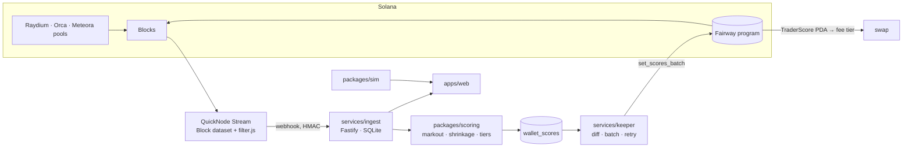

# Architecture

## Components

| Part | Role |
|---|---|
| `crates/fairway-math` | Pure Rust constant-product and LP math (u128, checked, rounds in the pool's favor). Tested with plain `cargo test`. |
| `programs/fairway` | Anchor program: `initialize_config`, `update_config`, `create_pool`, `add_liquidity`, `remove_liquidity`, `swap`, `set_score`, `set_scores_batch`, `close_score`, `settle_markout`, `update_retail_fee`, `configure_launch` (M16 launch curve + TWAP scoring). Emits `SwapExecuted`, `LaunchConfigured`. |
| `packages/scoring` | Canonical `Swap` type, markouts, shrinkage score, tier rules, `MidPriceProvider`s (fixture, pool-implied, Pyth stub), and cross-launch sniper scores (`sniper.ts`). |
| `packages/parser` | `getBlock`-shaped block → `Swap[]` (`core.ts`, inlined into `streams/filter.js`), and Pump.fun / PumpSwap launch trades (`pumpfun.ts`, bundled into `streams/pumpfun-filter.js`). |
| `services/ingest` | Receives webhooks (filter output or raw blocks), stores swaps (idempotent on `sig + pool`), recomputes scores, and serves read APIs. Launch trades go to `POST /streams/pumpfun` (idempotent on `sig + mint + kind`) and feed `GET /snipers`. |
| `services/keeper` | Diffs DB tiers with onchain scores and sends batched writes (TOXIC first). Dry-run by default. |
| `packages/sdk` | PDAs, instruction builders, account decoders, typed errors. Hand-written on web3.js, with the IDL checked in. |
| `packages/sim` | Seeded agent-based simulation, regimes, sweep, sensitivity, replay. |
| `apps/web` | Next.js app, mock mode by default, live mode with the wallet adapter. |

## Swap fee resolution (onchain)

1. `trader_score` must be the PDA `["score", signer]`. A mismatch fails the seeds constraint.
2. If settled onchain notional ≥ `config.markout.onchain_min_notional` and `trade_count` ≥ min(toxic, retail) min trades (5), use `onchain_tier` (source `Onchain`). Steps 3–5 are skipped.
3. If the account is empty, the wrong owner or the wrong size, use STANDARD.
4. If `current_slot − updated_slot > score_ttl_slots`, use STANDARD.
5. Otherwise read the bootstrap `tier`. An invalid tier maps to STANDARD.
6. If the 4-entry pending buffer is full, RETAIL is raised to STANDARD.
7. **Launch pools:** before `launch.launch_slot` the swap fails (`LaunchNotStarted`). Inside the window the fee is `end + ⌈(start − end) × (window − elapsed) / window⌉` from `Pool.launch.curve`, with no rebate. After the window, the normal rule below applies.
   Otherwise `fee = config.fee_bps[tier]`, minus the bot-tax rebate for RETAIL only (`min(pool.rebate_bps, budget left, fee − floor)`; see `update_retail_fee`). Pricing uses LP reserves: `vault balance − Pool.protocol_owed_*`. The fee is taken from the input, and `out = in_after_fee × reserve_out / (reserve_in + in_after_fee)`.
8. Slippage check against `min_amount_out`. The protocol's share `floor(premium × protocol_fee_bps / 10_000)`, where `premium` is the TOXIC fee above the STANDARD fee on the same input, is booked to `Pool.protocol_owed_*` / `protocol_earned_*` (LPs keep the rest), and the epoch counters (toxic premium, RETAIL volume, rebate given) are updated. Then emit `SwapExecuted`.
9. Record the post-trade LP-reserve price in the pool TWAP (`Pool.twap`, 64 observations ≥ 8 slots apart; also on add/remove liquidity).
10. If the pool has an oracle **or TWAP scoring** (launch pools): create the score PDA if missing (rent paid by the treasury PDA when it holds more than its rent-exempt minimum plus the rent, else by the trader; flagged `sponsored`) and queue `{pool, exec_price (pre-fee, 1e12 fixed point), slot, side, notional}`.

## Onchain markout settlement

`settle_markout(trader)` is permissionless and takes a `pool`. It expires pending trades older than `max_settle_slots`. If any of that pool's trades is at least `markout_slots` old, it validates the Pyth `PriceUpdateV2` account (address and feed id from `Pool.oracle_*`, owner, discriminator, full verification, feed id, staleness, confidence), or, on a launch pool without an oracle, uses the pool TWAP over the `twap_window_slots` (25) ending at the trade's horizon, with the post-trade spot as the execution reference. Then, for each trade whose horizon is before the price's `posted_slot`: `markout = side × (mid − exec) × 10⁴ / exec` (clamped ±10,000), `Σn += n`, `Σn·m += n·m`. It then sets `onchain_score_bps = Σn·m / (Σn + K)` and `onchain_tier` from the same thresholds as `packages/scoring` (history = slots since the first trade). The math lives in `crates/fairway-math/src/markout.rs` and is mirrored in `packages/scoring/src/onchain.ts` (shared vectors).

## Data modes

| Mode | Prices | Source of swaps |
|---|---|---|
| `DATA_MODE=fixture` | Simulated CEX path | `packages/fixtures` |
| `DATA_MODE=live` | Pool-implied mid (Pyth stubbed) | Streams webhook |

## Why vault-based matching
The filter watches pool **vault token accounts**. Any swap that moves them is visible, regardless of the AMM's program, instruction layout, or whether a router (Jupiter) invoked it. The cost is that fees on external pools are approximated from config.
