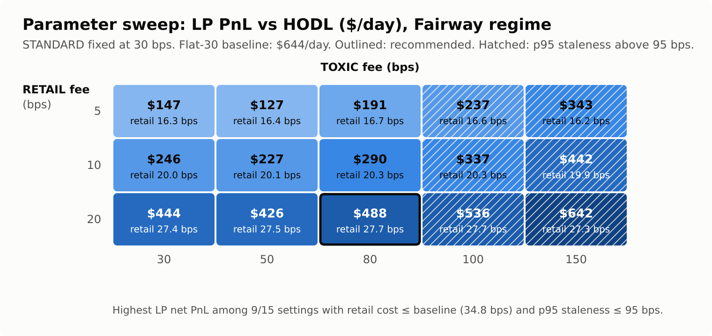
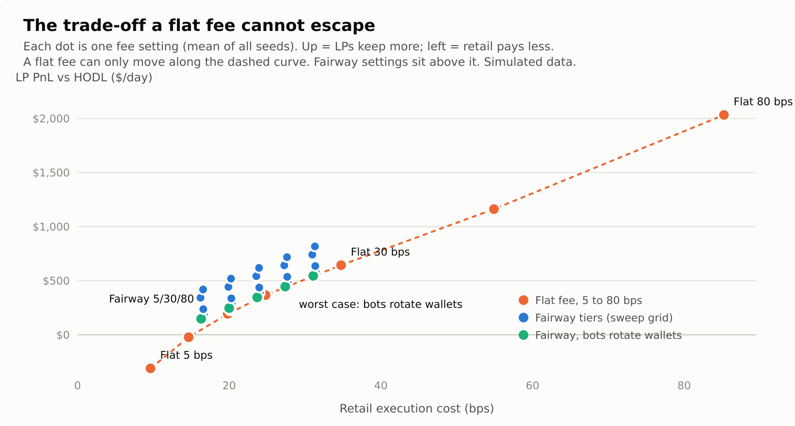

# Fairway economics

All numbers below come from the **synthetic** agent-based simulation in `packages/sim` (24 h, 60% vol, $3M TVL, 8 seeds). Regenerate with `pnpm sim`. They show the mechanism's trade-offs, not a forecast for mainnet.

## 1. Fee tiers

| Tier | Default fee | Who |
|---|---:|---|
| RETAIL | 5 bps | Wallets with ≥ 5 trades, ≥ 3 days of history and score ≤ 3 bps |
| STANDARD | 30 bps | Everyone else, **including every fresh wallet** |
| TOXIC | 80 bps | Wallets with ≥ 5 trades and score ≥ 10 bps |

The fee is charged on the input token and stays in the vault, so `k` never decreases. The score oracle chooses the *tier*. It cannot set a fee. The admin sets the three fees in `Config`.

## 2. Score and shrinkage

`markout_bps = side × (mid(t+h) − execPrice) / execPrice × 10,000`, using the pre-fee price. `score = Σ(notional·markout) / (Σ notional + K)`, `K = 2,000`.

Shrinkage matters for two reasons:

- **A single large lucky trade** has little weight against a prior of K notional. A wallet with one $50k trade is capped by `trades ≥ 5`, and its score is still averaged against the prior.
- **Small histories** are pulled toward 0, which means "not toxic". Because RETAIL also needs ≥ 5 trades and ≥ 3 days, a short history cannot earn a discount through the prior alone.

In the warm-up of the simulation (4,238 swaps over 72 h), the classifier gave: all 3 arbitrageurs and all 3 snipers → TOXIC; of 300 retail wallets, 145 → RETAIL, 154 → STANDARD, 1 → TOXIC (a false positive). 75% of retail wallets were classified, and the unclassified ones paid STANDARD, which is the safe failure mode.

## 3. Anti-gaming argument

- **Fresh wallets are never cheaper than STANDARD.** A bot that rotates wallets to dodge the TOXIC fee gets 30 bps, never 5. This is the key asymmetry: the default is the middle tier, not the cheap one.
- **Faking RETAIL is expensive.** To reach RETAIL a wallet must trade ≥ 5 times over ≥ 3 days with a volume-weighted markout ≤ 3 bps. A bot doing that has to trade like an uninformed user, or lose money on purpose (negative markout) to build the record, and then hope to earn the discount back on its informed trades. The shrinkage prior means a few informed trades after a long clean history shift the score only gradually, so the oracle should refresh scores often and TTLs should be short. This is a real attack surface: a "sleeper" wallet that builds RETAIL status and then trades informed flow once or twice before being re-scored. The TTL, refresh cadence and per-wallet notional caps are the defenses and are not fully solved (see RISKS.md).
- **Onchain verified scores.** For Fairway's own flow the program computes the score itself against Pyth (same formula, K and thresholds, one 30 s horizon). Once a wallet has 1,000 USDC and 5 trades of settled flow, keeper scores no longer apply. A bot can't buy a RETAIL label from a compromised keeper, and it can't hide trades: a full pending buffer means no RETAIL discount.
- **Wrong-signer attack.** A bot cannot pass someone else's RETAIL account: the `trader_score` account must match `["score", signer]`. Tested in `programs/fairway/tests/fairway.rs::wrong_signer_cannot_use_someone_elses_retail_score`.

## 4. What the simulation says

Per day, mean of 8 seeds. "LP fees − arb profit" is the LVR-style net (arb profit measured at the CEX mid).

| Regime | LP fees | Arb profit | Fees − arb | Retail cost | Mean / p95 staleness (bps) |
|---|---:|---:|---:|---:|---:|
| Flat 30 | $1,528 | $132 | $1,396 | 34.8 bps | 17.1 / 31.6 |
| Fairway 5/30/80 | $1,070 | $36 | $1,035 | 16.7 bps | 44.3 / 79.9 |
| Fairway 20/30/80 (recommended) | $1,366 | $36 | $1,331 | 27.7 bps | n/a / 79.9 |
| Fairway 5/30/80, arbs rotate | $1,035 | $132 | $903 | 16.3 bps | 17.1 / 31.6 |
| Flat 5 | $579 | $642 | −$63 | 9.6 bps | 4.0 / 8.5 |
| Flat 80 | $2,903 | $35 | $2,868 | 85.2 bps | 44.2 / 79.8 |

Retail cost is the fee plus price impact versus the CEX mid, in bps.

### Reading the table honestly

1. **Versus flat 30, LPs do not gain in this simulation.** At 5/30/80, LP PnL vs flat 30 is −$453/day (±$66). In the sim, retail volume is about 5× the informed volume, so the fee revenue lost on retail (30 → 5 bps) exceeds the extra revenue from TOXIC (30 → 80 bps). Informed flow also trades *less* when its fee is higher.
2. **Versus a low flat fee, Fairway is much better for LPs.** A flat 5 bps pool is the "retail-friendly" alternative, and it loses money after LVR. Fairway gives retail a similar fee (16.7 vs 9.6 bps cost, including impact) while LPs earn about $502/day more.
3. **Arbitrage profit drops about 73%** (from $132 to $36/day), and sniper profit drops about 70%.
4. **The cost is staleness.** The pool deviates more from the CEX price when toxic flow pays 80 bps: p95 deviation goes from 32 to 80 bps. Arbs wait for a bigger gap before trading. That is a real execution-quality cost for everyone (retail's price impact is measured against the CEX mid, so the effect is already in the retail cost column).
5. **Rotation worst case.** If arbs rotate wallets they pay STANDARD, so the pool behaves like flat 30 for them (same profit, same staleness), and retail still gets its discount. LPs bear that. The mechanism degrades to "retail subsidized by LPs", which is the weakest outcome. The recommended parameters reduce that exposure.

### Sensitivity (`packages/sim/out/sensitivity.json`, 4 seeds)

| Variation | Fairway 5/30/80 LP vs flat 30 | Retail saves |
|---|---:|---:|
| Baseline (elasticity 0) | −$527 | 16.8 bps |
| Retail fee elasticity 0.5 | −$417 | 18.2 bps |
| Retail fee elasticity 1 | −$293 | 17.6 bps |
| Informed flow ×0.25 | −$416 | 16.7 bps |
| Informed flow ×4 | −$855 | 17.0 bps |

Elasticity helps because lower retail fees attract more volume. It did not close the gap in the range we tested. Informed flow makes things worse, not better, because it is filtered out by the high fee rather than monetized. (The baseline row uses 4 seeds, which is why it differs from the 8-seed −$453.)

## 5. Choosing the parameters

The sweep covers toxic fee ∈ {30, 50, 80, 100, 150} bps × retail fee ∈ {5, 10, 20} bps (15 cells, 8 seeds each). The recommended setting maximizes LP net PnL subject to:

- retail cost ≤ the flat-30 baseline (34.8 bps), and
- p95 staleness ≤ **95 bps** (configurable).

Result: **toxic 80 bps, retail 20 bps** (the highest LP PnL among the 9 settings that pass both constraints). The binding constraint is staleness: toxic fees of 100 and 150 bps raise p95 deviation to 99 and 148 bps. Those fail the bound even though their raw LP PnL is higher. A 20 bps retail fee keeps most of the retail discount (30 → 20) and most of the LP revenue.

The `/backtest` page lets you move both sliders and see every regime, including rotation.

## 6. Historical replay

`pnpm --filter @fairway/sim replay -- --input swaps.jsonl` re-prices recorded swaps under each fee schedule. It is a **static counterfactual**: the trades are held fixed and only re-priced, so it cannot show how bots or retail would change behaviour. That is why the agent-based simulation exists. Use the replay for real backfill data (`GET /export.jsonl` on ingest) to get a first estimate of how much of the real flow would land in each tier.

## 7. Limits of the model

- One pool, one synthetic CEX price (GBM plus jumps), constant retail demand.
- Retail is price-insensitive by default. Real retail can route to other venues, and aggregators would pick Fairway only when it is the best price.
- Arbitrageurs and snipers are simple. Real searchers use priority fees and Jito bundles.
- Markout horizons are fixed (30 s primary). Real toxic flow may have longer or shorter horizons.
