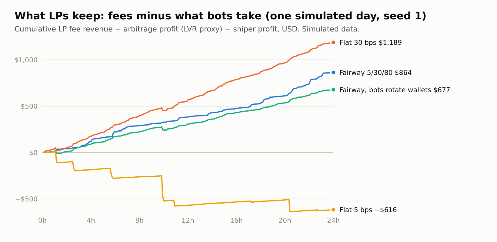

# Fairway economics

All numbers below come from the **synthetic** agent-based simulation in `packages/sim` (24 h, 60% vol, $3M TVL; 8 seeds for the original backtest, 16 paired seeds for the LP-first analysis). Regenerate with `pnpm sim` (everything) or `pnpm --filter @fairway/sim lpfirst` (LP-first only, writes `out/lpfirst.json`). They show the mechanism's trade-offs, not a forecast for mainnet.

**Since M16 the headline is launches:** [§8 Launch economics](#8-launch-economics-m16) covers the tier × time launch fee, its results over 200 simulated launches and who benefits. Sections 1–7 are the liquid-pair (SOL/USDC) evidence: the same engine, secondary.

**Since M15 the default is LP-first**: retail = standard = 30 bps, toxic 80 bps, and 10% of the toxic premium is rebated to proven-retail wallets. The earlier 5 / 30 / 80 design is kept as the "max retail discount" variant (§4b). Section 4 is the LP-first evidence, including the result that does **not** hold: no setting beats a flat 30 bps pool for LPs beyond the noise band.

## 1. Fee tiers

| Tier | Default fee | Who |
|---|---:|---|
| RETAIL | 30 bps − bot-tax rebate (floor 5 bps) | Wallets with ≥ 5 trades, ≥ 3 days of history and score ≤ 3 bps |
| STANDARD | 30 bps | Everyone else, **including every fresh wallet** |
| TOXIC | 80 bps | Wallets with ≥ 5 trades and score ≥ 10 bps |

The fee is charged on the input token and stays in the vault, so `k` never decreases. The score oracle chooses the *tier*. It cannot set a fee. The admin sets the three fees in `Config`. The shipped defaults are `[30, 30, 80]`.

**Toxic premium.** The part of a TOXIC swap's fee above what the STANDARD fee would have charged on the same input: `premium = fee − fee_on_input(amount, 30 bps)`. It is the only revenue the protocol touches, and the only source of the rebate.

**Protocol share.** `Config.protocol_fee_bps` (default 1,500 = **15% of the toxic premium**, max 5,000) is booked to the protocol (`Pool.protocol_owed_*`, rounded down so LPs keep the dust). LPs keep every other fee in full. It stays in the vault but is excluded from the reserves that price the curve and from LP shares, until `claim_protocol_fees` moves it to the treasury PDA. Why premium-only rather than a share of all fees: a share of all fees takes from LPs on every swap, including the ones that bring no new money (§4 shows that costs LPs $139–215/day at 10–15%, versus $56/day for 15% of the premium).

**Bot-tax rebate.** Each epoch (`Config.rebate.epoch_slots`, default 9,000 slots ≈ 1 hour) the pool counts the toxic premium and the RETAIL-tier volume it saw. The permissionless `update_retail_fee` instruction then sets, for the next epoch, `rebate_bps = min(share × premium ÷ retail_volume, retail_fee − floor)` (defaults: share 10%, floor 5 bps) and a **budget** of `share × premium`. A RETAIL-tier swap gets at most the epoch rate, at most what is left of the budget, and never a fee below the floor, so the rebate handed out can never exceed `share × premium` (plus at most one token unit of rounding per swap). An epoch with no toxic flow sets the rebate to 0. STANDARD and TOXIC wallets never get it, so a bot that rotates to fresh wallets gets no discount. Tests: `programs/fairway/tests/fairway.rs` (`rebate_*`, `epoch_roll_*`, `zero_toxic_volume_*`, `skipped_epochs_*`) and `crates/fairway-math/src/rebate.rs`.

## 2. Score and shrinkage

`markout_bps = side × (mid(t+h) − execPrice) / execPrice × 10,000`, using the pre-fee price. `score = Σ(notional·markout) / (Σ notional + K)`, `K = 2,000`.

Shrinkage matters for two reasons:

- **A single large lucky trade** has little weight against a prior of K notional. A wallet with one $50k trade is capped by `trades ≥ 5`, and its score is still averaged against the prior.
- **Small histories** are pulled toward 0, which means "not toxic". Because RETAIL also needs ≥ 5 trades and ≥ 3 days, a short history cannot earn a discount through the prior alone.

In the warm-up of the simulation (4,238 swaps over 72 h), the classifier gave: all 3 arbitrageurs and all 3 snipers → TOXIC; of 300 retail wallets, 145 → RETAIL, 154 → STANDARD, 1 → TOXIC (a false positive). 75% of retail wallets were classified, and the unclassified ones paid STANDARD, which is the safe failure mode.

## 3. Anti-gaming argument

- **Fresh wallets are never cheaper than STANDARD.** A bot that rotates wallets to dodge the TOXIC fee gets 30 bps, never 5. This is the key asymmetry: the default is the middle tier, not the cheap one.
- **Faking RETAIL is expensive.** To reach RETAIL a wallet must trade ≥ 5 times over ≥ 3 days with a volume-weighted markout ≤ 3 bps. A bot doing that has to trade like an uninformed user, or lose money on purpose (negative markout) to build the record, and then hope to earn the discount back on its informed trades. The shrinkage prior means a few informed trades after a long clean history shift the score only gradually, so the oracle should refresh scores often and TTLs should be short. This is a real attack surface: a "sleeper" wallet that builds RETAIL status and then trades informed flow once or twice before being re-scored. The TTL, refresh cadence and per-wallet notional caps are the defenses and are not fully solved (see RISKS.md).
- **Onchain verified scores.** For Fairway's own flow the program computes the score itself against Pyth (same formula, K and thresholds, one 30 s horizon). Once a wallet has 1,000 USDC and 5 trades of settled flow, keeper scores no longer apply. A bot can't buy a RETAIL label from a compromised keeper, and it can't hide trades: a full pending buffer means no RETAIL discount.
- **Wrong-signer attack.** A bot cannot pass someone else's RETAIL account: the `trader_score` account must match `["score", signer]`. Tested in `programs/fairway/tests/fairway.rs::wrong_signer_cannot_use_someone_elses_retail_score`.

## 4. LP-first results (the default)

Per day, **paired against a flat 30 bps pool in the same random world** (common random numbers), 16 seeds, no retail elasticity. "±" is one standard error across seeds; the noise band is 2 standard errors. Flat 30 reference (per day): LP fees $1,528, arb profit $132, sniper profit $145, LP PnL vs HODL $683, retail cost 34.8 bps, p95 staleness 31.6 bps.

**Result in one sentence: this design cuts what bots extract from LPs by about 73% and retail never pays more than in a normal pool, but LP PnL is statistically indistinguishable from a flat 30 bps pool before the protocol share and slightly worse after it. No setting in the requested grid beats flat 30 for LPs beyond the noise band.**

| Setting | LP vs flat 30 before protocol ($/day) | after protocol ($/day) | Retail cost Δ (bps) | LVR cut | p95 stale Δ (bps) | Bot premium $/day | Rebate $/day | Protocol $/day |
|---|---:|---:|---:|---:|---:|---:|---:|---:|
| Retail = standard = 30, toxic 40 | −$12 ± 15 | −$39 ± 15 | +0.1 ± 0.1 | 39% | +9 | 176 | 0 | 26 |
| Retail = standard = 30, toxic 50 | −$8 ± 19 | −$51 ± 18 | +0.2 ± 0.2 | 57% | +19 | 283 | 0 | 42 |
| Retail = standard = 30, toxic 60 | +$5 ± 24 | −$49 ± 23 | +0.3 ± 0.4 | 66% | +29 | 360 | 0 | 54 |
| Retail = standard = 30, toxic 80 | +$54 ± 35 | −$17 ± 32 | +0.4 ± 0.6 | 73% | +48 | 478 | 0 | 72 |
| Retail = standard = 30, toxic 100 | +$87 ± 48 | +$4 ± 44 | +0.3 ± 0.9 | 79% | +67 | 555 | 0 | 83 |
| Toxic 40, rebate 10% of premium | −$27 ± 15 | −$53 ± 15 | −0.5 ± 0.1 | 39% | +9 | 176 | 14 | 26 |
| Toxic 50, rebate 10% of premium | −$32 ± 19 | −$74 ± 18 | −0.7 ± 0.3 | 57% | +19 | 283 | 23 | 42 |
| Toxic 60, rebate 10% of premium | −$24 ± 24 | −$78 ± 22 | −0.8 ± 0.4 | 66% | +29 | 360 | 29 | 54 |
| Toxic 80, rebate 10% of premium **(default)** | +$15 ± 33 | −$56 ± 31 | −1.0 ± 0.7 | 73% | +48 | 478 | 39 | 72 |
| Toxic 100, rebate 10% of premium | +$42 ± 46 | −$41 ± 41 | −1.4 ± 0.9 | 79% | +67 | 555 | 46 | 83 |
| Toxic 40, rebate 25% of premium | −$48 ± 15 | −$75 ± 15 | −1.3 ± 0.2 | 39% | +9 | 176 | 36 | 26 |
| Toxic 50, rebate 25% of premium | −$66 ± 18 | −$109 ± 18 | −2.0 ± 0.3 | 57% | +19 | 283 | 58 | 42 |
| Toxic 60, rebate 25% of premium | −$68 ± 23 | −$122 ± 21 | −2.5 ± 0.4 | 66% | +29 | 360 | 73 | 54 |
| Toxic 80, rebate 25% of premium | −$42 ± 31 | −$114 ± 29 | −3.2 ± 0.7 | 73% | +48 | 478 | 97 | 72 |
| Toxic 100, rebate 25% of premium | −$24 ± 43 | −$108 ± 39 | −3.8 ± 0.9 | 79% | +67 | 555 | 111 | 83 |
| Toxic 40, rebate 50% of premium | −$85 ± 15 | −$111 ± 15 | −2.6 ± 0.2 | 39% | +9 | 176 | 72 | 26 |
| Toxic 50, rebate 50% of premium | −$123 ± 18 | −$166 ± 18 | −4.1 ± 0.3 | 57% | +19 | 283 | 115 | 42 |
| Toxic 60, rebate 50% of premium | −$139 ± 22 | −$193 ± 21 | −5.1 ± 0.5 | 66% | +29 | 360 | 144 | 54 |
| Toxic 80, rebate 50% of premium | −$125 ± 30 | −$197 ± 27 | −6.2 ± 0.8 | 73% | +48 | 478 | 179 | 72 |
| Toxic 100, rebate 50% of premium | −$103 ± 42 | −$186 ± 38 | −6.7 ± 0.9 | 79% | +67 | 555 | 189 | 83 |

Why LPs do not gain: raising the toxic fee cuts arbitrage profit (the LVR proxy) a lot, but arbitrageurs were also paying LPs fees on that volume, and they trade less at a higher fee. The two nearly cancel. The "bot premium" column is what bots pay above the standard fee; it is real money but small next to the LP PnL noise (±$30–45/day).

**Extension rows (outside the requested 40–100 grid, never recommended).** A very high toxic fee does lift LP PnL vs flat 30, at the cost of a much staler pool (+116 to +163 bps at p95) and a still-insignificant result:

| Setting | LP vs flat 30 before protocol ($/day) | after protocol ($/day) | Retail cost Δ (bps) | LVR cut | p95 stale Δ (bps) | Bot premium $/day | Rebate $/day | Protocol $/day |
|---|---:|---:|---:|---:|---:|---:|---:|---:|
| Retail = standard = 30, toxic 150 | +$154 ± 81 | +$53 ± 73 | +0.2 ± 1.3 | 86% | +116 | 670 | 0 | 101 |
| Retail = standard = 30, toxic 200 | +$213 ± 119 | +$103 ± 105 | +0.2 ± 1.6 | 90% | +163 | 730 | 0 | 109 |
| Max retail discount 5 / 30 / 80 (previous design) | −$451 ± 38 | −$523 ± 34 | −18.2 ± 0.7 | 73% | +48 | 479 | 0 | 72 |

### Protocol share options

Tested at the default setting (toxic 80, rebate 10%):

| Protocol option | Protocol $/day | LP vs flat 30 after protocol ($/day) | beats noise |
|---|---:|---:|---|
| 15% of all fees (M14 default) | 231 | −$215 ± 29 | no |
| 10% of all fees | 154 | −$139 ± 31 | no |
| 5% of all fees | 77 | −$62 ± 32 | no |
| 15% of the toxic premium only | 72 | −$56 ± 31 | no |
| 30% of the toxic premium only | 143 | −$128 ± 28 | no |

A share of all fees is a transfer out of LPs on every swap, and any positive protocol share lowers LP net by definition (LP PnL before protocol is ≈ 0 ± noise, so nothing after it can beat flat 30). Among the options, **15% of the toxic premium only** costs LPs the least relative to the revenue it raises ($72/day on a $3M pool, about $26k/year) and is the only protocol revenue that is strictly paid by bots. 5% of all fees costs LPs about the same ($62/day) and would earn revenue even without bot flow, but it takes from LPs on every swap, including retail swaps that bring no new money. The premium-only share has the cleaner story (the protocol is paid only when bots pay a premium), so that is the default.

### How the defaults were chosen

Goal order: (1) LP net after the protocol share beats flat 30 beyond noise; (2) retail cost ≤ flat 30; (3) p95 staleness reasonable. **Goal 1 cannot be met in this simulation.** The selection rule therefore was: among rebate settings in the requested grid with retail cost strictly below flat 30 and p95 staleness at most +50 bps vs flat 30, take the settings whose LP net is within 2 standard errors of the best and pick the one with the largest LVR cut. That gives **toxic 80 bps, rebate 10% of the premium, floor 5 bps, protocol 15% of the premium**:

| Metric (vs flat 30, per day) | Default |
|---|---|
| LVR (arbitrage profit) | −73% |
| LP PnL before protocol share | +$15 ± 33 (within noise) |
| LP PnL after protocol share | −$56 ± 31 (about 0.7% APR on $3M TVL; not a gain) |
| Retail cost | −1.0 ± 0.7 bps (never higher) |
| p95 staleness | +48 bps (32 → 80) |
| Worst case, all bots rotate wallets | LP +$1, retail ±0.0 bps: it becomes a plain 30 bps pool |

Why not a bigger rebate: each 10% of the premium handed to retail costs LPs about $40/day here, and 25% puts LPs −$42 ± 31/day below flat 30 before the protocol share (borderline) while 50% puts them −$125 ± 30 below (clearly worse). The rebate is what makes "retail never pays more" true with margin; without it, retail cost is +0.4 ± 0.6 bps vs flat 30 at toxic 80 (equal within noise, slightly worse mean, because the pool is staler). Governance can set `rebate.share_bps` to 0 to turn it off, or raise it, via `update_config`.

### Elasticity (extra, assumption-driven)

Retail arrival rate × (1 + e·(30 − fee)/30)/(1 + e). Real elasticity is unmeasured; this is not part of the headline. Default setting, 8 paired seeds, LP vs flat 30 per day:

| Retail elasticity | LP before protocol | LP after protocol | Retail cost Δ (bps) |
|---|---:|---:|---:|
| 0.5 | +$18 ± 60 | −$52 ± 53 | −0.7 |
| 1 | +$48 ± 51 | −$22 ± 45 | −0.9 |

Because the default retail discount is only ~2 bps, volume barely responds, which is why this matters less than for the 5 / 30 / 80 design (§4b).

## 4b. Previous design: max retail discount (5 / 30 / 80)

The original M3–M14 results, kept as an option for pools that want to attract retail flow and accept lower LP returns. The protocol share in this section's tables is the old 15% of all fees.

Per day, mean of 8 seeds, 24 h, 60% vol, $3M pool. **LP PnL vs HODL** is the complete LP result (reserves plus fees at the final CEX price, minus holding the initial reserves). It already contains every loss to arbitrageurs and snipers, so it is the LVR check: "fees − arb profit" alone ignores sniper losses and rebalancing. The protocol keeps `protocol_fee_bps` (15%) of swap fees, so LPs keep the rest; the flat-30 reference pool is shown with LPs keeping 100%.

| Regime | LP fees | Arb profit | LP PnL vs HODL | LP PnL after protocol share | Retail cost | Mean / p95 staleness (bps) |
|---|---:|---:|---:|---:|---:|---:|
| Flat 30 (reference) | $1,528 | $132 | $644 | $644 | 34.8 bps | 17.1 / 31.6 |
| Fairway 5/30/80 (demo fees) | $1,070 | $36 | $191 | $30 | 16.7 bps | 44.3 / 79.9 |
| Fairway 20/30/200 (sweep pick) | $1,529 | $13 | $718 | $489 | 27.6 bps | n/a / 196 |
| Fairway 5/30/80, arbs rotate | $1,035 | $132 | $148 | −$7 | 16.3 bps | 17.1 / 31.6 |
| Flat 5 | $579 | $642 | −$311 | −$398 | 9.6 bps | 4.0 / 8.5 |
| Flat 80 | $2,903 | $35 | $2,033 | $1,597 | 85.2 bps | 44.2 / 79.8 |

Retail cost is the fee plus price impact versus the CEX mid, in bps (it includes the effect of a staler pool).

### Reading the table honestly (5 / 30 / 80)

Question checked on 2026-11-19: *do LPs earn more than in a flat 30 bps pool while retail pays less?* **Not unconditionally.**

1. **Retail pays less, bots pay more.** At 5/30/80 retail saves 18 bps. Arbitrage profit falls 73% (90% at 20/30/200). Bots pay about $475/day more than the STANDARD fee on the same volume (the "extra fees from bots" number on `/pool`).
2. **The retail discount is paid by LPs.** In the sim, retail volume is about 5× the informed volume, so revenue lost on retail (30 → 5 bps) exceeds the extra from TOXIC (30 → 80 bps), and informed flow trades less when its fee is higher. At 5/30/80, LP PnL vs flat 30 is −$453/day (±66). Rule of thumb on this pool: ~$20/day per bp of retail saving.
3. **A high toxic fee closes the gap at a price.** At 20/30/200, LP PnL vs flat 30 is +$74/day before the protocol share (±214, not statistically different from 0) and −$155/day after it. Retail saves 7.1 bps. The price is staleness: p95 deviation 196 bps vs 32 bps, because arbs wait for a larger gap before trading.
4. **Versus a low flat fee, Fairway is much better for LPs.** A flat 5 bps pool (similar retail cost) loses money after LVR. 5/30/80 gives LPs about $500/day more than flat 5.
5. **Rotation worst case.** If arbs rotate wallets they pay STANDARD: same profit, same staleness as flat 30, and retail still gets its discount. LPs bear that (−$496/day vs flat 30 at 5/30/80, −$196 at 20/30/200). Raising STANDARD to 40–50 bps narrows it (below) but makes fresh wallets pay more than the baseline.

### Elasticity (an assumption, labeled)

Retail arrival rate × (1 + e·(30 − fee)/30) / (1 + e): at `e = 1`, a wallet paying 15 bps instead of 30 trades ~33% more. Real elasticity depends on aggregator routing and is unmeasured here. LP PnL vs flat 30 per day, **before / after** the 15% protocol share (`sensitivity.json`, `sensitivity-recommended.json`; 4 seeds):

| Retail elasticity | 5/30/80 | 20/30/200 |
|---|---:|---:|
| 0 | −$527 / −$673 | +$127 / −$104 |
| 0.25 | −$386 / −$547 | +$184 / −$54 |
| 0.5 | −$417 / −$567 | +$132 / −$92 |
| 1 | −$293 / −$466 | +$339 / +$79 |

Elasticity-labeled sweeps are in `sweep-elastic.json` (e = 0.5 and 1; every toxic × retail cell with LP-vs-flat-30 before and after the protocol share, retail saving and staleness). With e = 1 the sweep pick moves to 10/30/200. LPs beat flat 30 after the protocol share only in the high-toxic-fee, e ≥ 1 corner.

Other sensitivities (5/30/80 → 20/30/200 LP vs flat 30, before protocol share): informed flow ×0.25: −$416 → +$233; ×2: −$585 → +$66; ×4: −$855 → −$202. More informed flow hurts: it is filtered out by the high fee rather than monetized. STANDARD fee in the rotation case (5/30/80): 30 → −$513, 40 → −$469, 50 → −$409 (4 seeds).

## 5. Choosing the parameters (5 / 30 / 80 sweep)

(The LP-first defaults are chosen in §4. This section is the older retail-fee sweep.)

The sweep covers toxic fee ∈ {30, 50, 80, 100, 150, 200} bps × retail fee ∈ {5, 10, 15, 20, 25} bps (30 cells, 8 seeds each, STANDARD fixed at 30). The pick maximizes **LP PnL after the protocol's fee share** subject to:

- retail cost saved ≥ **5 bps** vs flat 30 (smaller savings are within noise), and
- p95 staleness ≤ **200 bps** (configurable). Staleness reaches users through retail cost, which is already measured, but a very stale pool price is also a risk for anything that reads it as an oracle.

Result: **toxic 200 bps, retail 20 bps** (24 of 30 cells pass). Nothing in the grid gives LPs more than flat 30 after the protocol share with a robust retail saving at elasticity 0, so the pick is the least costly one that still delivers a meaningful retail saving. The frontier is a transfer: every bp saved for retail costs LPs about $20/day unless toxic fees or volume make up for it.

The `/backtest` page lets you move both sliders and see every regime, including rotation.

## 6. Historical replay

`pnpm --filter @fairway/sim replay -- --input swaps.jsonl` re-prices recorded swaps under each fee schedule. It is a **static counterfactual**: the trades are held fixed and only re-priced, so it cannot show how bots or retail would change behaviour. That is why the agent-based simulation exists. Use the replay for real backfill data (`GET /export.jsonl` on ingest) to get a first estimate of how much of the real flow would land in each tier.

## 7. Limits of the model

- One pool, one synthetic CEX price (GBM plus jumps), constant retail demand.
- Retail is price-insensitive by default. Real retail can route to other venues, and aggregators would pick Fairway only when it is the best price.
- Arbitrageurs and snipers are simple. Real searchers use priority fees and Jito bundles.
- Markout horizons are fixed (30 s primary). Real toxic flow may have longer or shorter horizons.

## 8. Launch economics (M16)

Fairway Launch puts the engine where informed flow is most extreme: the first minutes of a new token. Simulation: `packages/sim/src/launch.ts`, 200 seeded launches, output `packages/sim/out/launch.json`, regenerate with `pnpm --filter @fairway/sim launch`. **Synthetic.**

### 8.1 The fee

A launch pool stores a per-tier curve `[start, end]` and a window (default 750 slots ≈ 5 min). In the window, `fee(tier, elapsed) = end + ⌈(start − end) × (window − elapsed) / window⌉`, rounded up so the pool never undercharges. After the window it reverts to the `Config` tier fees.

| Tier | Start | End | Rationale |
|---|---:|---:|---|
| TOXIC (known snipers) | 1000 bps | 80 | High enough that a sniper's expected edge in the first seconds (in the sim, a 30–100% take-profit target, accepting at most 150–700 bps of fee) is mostly gone. |
| STANDARD (no history, fresh wallets) | 300 bps | 30 | **Equal to the time-decay baseline.** A fresh wallet must never beat the incumbent anti-sniper design, so wallet rotation can only remove the surcharge. |
| RETAIL (proven uninformed history) | 30 bps | 5 | Humans who have traded before should not be taxed for being early. |

Other choices: no bot-tax rebate inside the window (the premium stays with the creator's pool), swaps refused before `launch_slot`, `configure_launch` only before the first swap (a creator can't change the rules mid-launch), and a 0.05 SOL launch fee for non-admin creators.

### 8.2 Agents

Per launch: $10k–40k of initial liquidity at a fixed listing price; **snipers** (2–8, 75% known from past launches → TOXIC from slot 0, 25% on fresh wallets → STANDARD), who buy in the first slots only if their expected profit beats the fee and take profit 30–100% higher or after a holding limit; in half the launches a **bundler** splitting ~$6k over 3–8 fresh wallets in the first 20 slots; **humans** (~160 buys, median $80, a hype-driven arrival rate that decays over ~2 minutes; 60% have RETAIL history, 40% are new wallets); and a few **good bots** (small DCA buys, RETAIL history). The price is the constant-product pool itself: there is no arbitrage and no outside market.

### 8.3 Results (means over 200 launches)

| Regime | Human fee | Humans paying ≥ 100 bps | Known-sniper fee | All-sniper fee | Sniper share of window supply | Human entry vs listing | Sniper profit | Creator fees | Protocol |
|---|---:|---:|---:|---:|---:|---:|---:|---:|---:|
| Flat 30 | 30 | 0% | 30 | 30 | 54% | +163% | $6,918 | $220 | $7.50 |
| Time-decay 300 → 30 | 200 | 84% | 245 | 241 | 49% | +160% | $5,325 | $1,399 | $7.50 |
| Time-decay 1000 → 30 | 641 | 90% | 314 | 319 | 1% | +117% | $71 | $1,458 | $7.50 |
| **Fairway** | **94** | **34%** | **371** | 250 | **27%** | **+129%** | **$2,432** | $591 | $8.59 |
| Fairway, all snipers rotate | 94 | 34% | 246 | 241 | 49% | +158% | $5,346 | $1,156 | $7.50 |

Fees in bps, per trade in the window. Paired across identical launches: **humans pay 53% less than under time-decay, in every launch**. Known snipers pay 1.46× more per trade. The pooled sniper fee is 1.01× time-decay. Known snipers mostly don't buy at all: only 36% of all snipers trade under Fairway, vs 81% under time-decay, and known-sniper notional falls from $25k to under $300 per launch.

How to read it:

- **Fairway beats both time-decay curves for humans.** The 300 → 30 curve lets snipers take half the window supply and still charges humans 200 bps. The 1000 → 30 curve stops snipers, but charges humans 641 bps. Fairway gets most of the 1000-curve's deterrence on known snipers at a third of the 300-curve's cost to humans.
- **It does not beat time-decay on snipers it has never seen.** Fresh-wallet snipers and bundlers pay the STANDARD curve, which is the time-decay curve. The rotation row shows the floor: identical sniper outcomes to time-decay, and humans with history still better off. Bundles are handled by the funding check (§8.5b).
- **Price discovery.** Because known snipers stay out, the first human buyers enter closer to the listing price (+129% vs +160% on average over listing).

### 8.4 Who benefits

| Who | Gets | Gives up |
|---|---|---|
| **Creators** | A fairer distribution (sniper share 27% vs 49%), buyers who are actual holders, a launch story ("snipers pay 10%"), and **50% of the sniper premium paid to them directly** (§8.4b; ~$3.63 per launch on average, because most known snipers stay out) | **Fee income:** $591 vs $1,399 per launch under time-decay, because time-decay income comes mostly from humans. Still 2.7× a flat-30 pool. The creator chooses the curve (`configure_launch` accepts a custom one), so a creator who wants more income can raise the STANDARD start. |
| **Retail (humans)** | 94 bps instead of ~200 in the window; only a third of human buys pay ≥ 100 bps (vs 84%); a lower average entry price | Nothing vs time-decay. New wallets pay the time-decay curve, exactly as today. |
| **LPs / creators** | On a launch pool the creator is usually the only LP, so LP income = creator fees above. Later LPs get all swap fees except the protocol's premium share, and a pool whose early price was not set by snipers | The same trade-off as the creator. |
| **Protocol** | The **0.05 SOL launch fee** (~$7.50) on every non-admin launch, plus **15% of the toxic premium** (the TOXIC fee above STANDARD) on launch and liquid pools: $8.59 per simulated launch in total | Rent sponsorship for first swaps (about 0.0023 SOL per new wallet) when the treasury can afford it. |
| **Known snipers** | — | Most of their edge: profit falls 54% vs time-decay. |

### 8.4b Creator share of the sniper premium (default 50%)

The **premium** is what a TOXIC wallet pays above the STANDARD (fresh-wallet) fee at that moment. Onchain, `configure_launch(…, creator_share_bps)` sets the creator's share of it (default `Config.launch.creator_premium_share_bps` = 5000 = 50%; creator + protocol ≤ 100% is enforced, and `fairway_math::launch::creator_share` caps the cut at premium − protocol share even if the protocol fee is raised later). The swap books it in `Pool.creator_owed_*`, which is excluded from LP reserves like the protocol share. Anyone can call `claim_creator_fees`, but it pays only into token accounts owned by `Pool.creator`. Tested: `creator_gets_its_share_of_the_toxic_premium_excluded_from_reserves_and_claimable`, `creator_share_is_configurable_and_bounded`.

Per launch, Fairway regime, mean of 200 launches (`launch.json` → `creatorShare`):

| Creator share | Paid to the creator directly | LP fees | Creator total if it is the only LP |
|---:|---:|---:|---:|
| 0% | $0.00 | $591 | $591 |
| 25% | $1.81 | $589 | $591 |
| **50% (default)** | **$3.63** | **$587** | **$591** |
| 75% | $5.44 | $585 | $591 |
| 85% (max with a 15% protocol share) | $6.17 | $584 | $591 |
| *Time-decay-only (no premium exists)* | $0 | $1,399 | $1,399 |

The trade-off, stated plainly:

- **The premium is small because deterrence works.** Known snipers face 1000 bps at block 0 and mostly don't buy, so the premium is only ~$7 per launch. Fairway cannot both keep snipers out and collect a lot of money from them. Every sniper it deters is premium it doesn't collect.
- **The share moves money; it does not create any.** It changes no fee a trader pays, so supply share, human fees and sniper behaviour are identical across the rows. It moves premium from LPs to the creator. For a creator who is the pool's only LP, the total is $591 at any share.
- **Why have it at all?** Launch liquidity is often locked or burned, and other LPs join after the window. In both cases the creator would otherwise earn nothing from snipers. The share makes "snipers pay you" true for the creator in every case. On a launch where known snipers do buy, the per-trade amounts are large: a $2,000 known-sniper buy at block 0 pays $200, $70 of it premium, so $35 goes to the creator.
- **Fair distribution vs fee income.** A creator who is the only LP earns $591 per launch on Fairway vs $1,399 under time-decay-only, because time-decay income comes mostly from humans paying 200 bps. The creator gets a holder base with half the sniper share (27% vs 49%) and humans who paid 53% less. A creator who wants more income can raise the STANDARD start of the curve (`configure_launch` accepts a custom curve). That raises fresh-wallet fees for humans too, which is exactly the time-decay trade-off.

### 8.5 After the window: scoring without an oracle

A new token has no Pyth feed, so `configure_launch` enables **TWAP scoring**. The pool keeps a cumulative price × slots accumulator (64 observations ≥ 8 slots apart), updated after every swap and liquidity change. A trade's markout reference is the **25-slot TWAP ending 75 slots after the trade**, and its execution reference is the **post-trade spot price**. A buyer's own price impact is therefore not counted as "the price moved in my favour", and a trade into a pool that does not move afterwards scores 0 (tested: `twap_scoring_of_a_price_that_did_not_move_is_zero`). Wallets thus build onchain-verified scores on the very token they launched into. Manipulation risks are in [`RISKS.md` §1d](RISKS.md).

### 8.5b Bundle detection (Stream L funding check)

**Mechanism** (`streams/STREAM_CONFIG.md` §Bundle detection): Stream L also extracts SOL fundings of brand-new wallets. Two or more early buyers of one launch funded by the same source within 1,500 slots before it form a bundle, and those wallets pay **at least STANDARD**. A funder seen in ≥ 2 bundled launches is a **known bundler**: every new wallet it funds afterwards is flagged before it buys, and pays **TOXIC**.

**Sim regime "Fairway + bundle detection"**: identical to Fairway, except that the bundle wallets pay the TOXIC curve when their funder is a known bundler. We **assume** that holds for 60% of bundles (`bundler.detectShare`; drawn from its own RNG stream, so every other regime is unchanged). Over the 100 launches that have a bundle:

| Regime | Bundle share of early supply | Snipers + bundles share | Bundle wallets' fee (pooled) |
|---|---:|---:|---:|
| Time-decay 300 → 30 | 10.5% | 56% | 204 bps |
| Fairway | 20.3% | 39% | 227 bps |
| **Fairway + bundle detection** | **7.5%** | **27%** | 228 bps |

Over all 200 launches the sniper + bundle share falls from 27% to 21%, and humans pay the same 94 bps. How to read it:

- **Without detection, Fairway helps bundles.** Keeping known snipers out leaves the early supply to fresh wallets, so the bundle share doubles vs time-decay. Detection is what closes that gap, so it belongs in the design, not on the wish list.
- **The bundle fee barely moves (227 → 228 bps)** for the same reason as with snipers: detected bundles face 1000 bps and mostly skip. The bundles that still buy are the undetected ones, which pay STANDARD.
- **Creators lose a bit more fee income** ($591 → $494 per launch), because the deterred bundles paid fees too. Same trade-off as §8.4b.
- **Limits:** the 60% is an assumption, not a measurement. One hop only: funding through an exchange or a fresh intermediate wallet is not linked. Flags that arrive after a wallet's first buy only help with the next launch. See [`RISKS.md` §10b](RISKS.md).

### 8.6 Limits

- Synthetic agents with simple rules. Real snipers adapt: they may rotate more once Fairway exists, which pushes outcomes toward the rotation row.
- Known-sniper detection is assumed at 75% coverage. The real coverage depends on Stream L's backfill and on how many snipers reuse wallets. That is not measured yet.
- Humans are not fee-elastic in the launch sim. In reality lower fees may bring more buyers, which would raise creator fees.
- No outside market or arbitrage: the pool is the only venue.

## 9. Fairway Check: the token report

Fairway Check (`/check`, `packages/scoring/src/check.ts`) grades a token launch for buyers. It uses the same launch trades and the same cross-launch sniper scores as the launch fee tiers (§8). It prices nothing; it only reports.

**Definitions** (over the *early window*: the 150 slots, about 60 seconds, after the launch slot):

| Metric | Definition |
|---|---|
| Sniper share of early supply | tokens bought by TOXIC wallets in the window ÷ all tokens bought in the window. A wallet is TOXIC if the sniper scorer says so (bought early in ≥ 3 launches, shrunk markout ≥ 500 bps), or if a known bundler funded it. |
| New-wallet share | early buyers with no trade on any other token before this launch ÷ early buyers. Shown, not graded: almost every buyer of a brand-new token is new. |
| Dumped already | tokens the early snipers have sold (after their first early buy) ÷ tokens they bought in the window, capped at 100% per wallet. |
| Early buyers | distinct wallets that bought in the window. Fewer than 5 adds a "weak signal" note. |

**Grade thresholds** (`DEFAULT_CHECK_CONFIG`, one config object):

| Grade | Rule |
|---|---|
| **High** | sniper share ≥ 30%, **or** ≥ 15% with at least 50% of the snipers' bags already sold |
| **Medium** | sniper share ≥ 10% |
| **Low** | below that |
| **Fair launch verified** | sniper share < 10% **and** ≥ 10 early buyers (the badge on `/check` and `/launch/[id]`; on a launch page it appears once the 60 s window has closed) |

**Why these numbers.** They are judgment calls, not fitted to data: 30% means the snipers alone could set the price; 15% plus a dump means a meaningful minority that is already exiting; 10% is roughly what a handful of snipers hold on a launch that other tools would not flag. They are one config object so they can be changed in one place, and the unit tests pin the boundaries (`gradeOf`). In the synthetic fixture the grades come out as designed (Low, Medium and High tokens), which tests the code, not the thresholds. **They have not been calibrated against real launches.**

**Limits.**
- **Known snipers only.** A sniper on a fresh wallet cannot be identified in advance, so Check understates sniper share on launches where snipers rotate wallets. The `/launch/[id]` page shows both numbers side by side for this reason.
- **Launch anchoring.** The early window starts at the `create` instruction. If the Stream started after the token launched, the first trade seen is used instead, and the window is wrong. Only trust a report for tokens that launched after the Stream started.
- **Pre-fee, pool-implied prices.** Markouts use the token's own trade prices; no oracle exists for a new token.
- **Labels can be wrong.** A human who buys early in three launches that then pump can be labelled TOXIC. See [`RISKS.md` §10f](RISKS.md).
